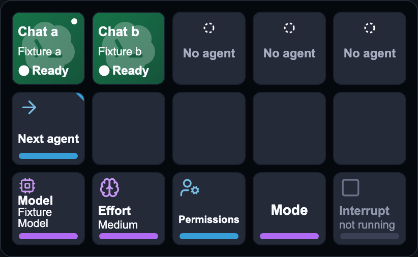
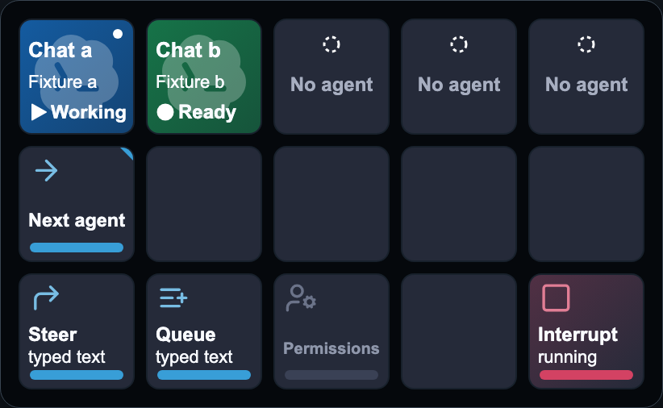
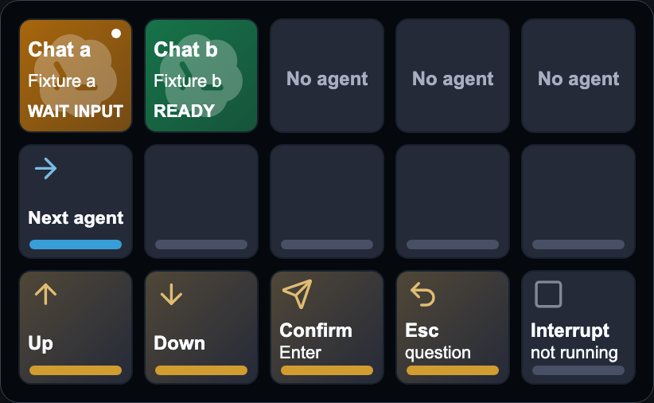

# DeckShep

DeckShep puts the Codex CLI and Claude Code sessions you already run in Rex on your 15-key Stream Deck MK.2. Tap an agent to focus its terminal pane. The bottom row follows that agent, so the same keys you use to change models while idle can steer a reply or answer a question when the session needs you.



**Beta scope.** Rex on macOS is the only backend tested with either CLI and the only profile included in the beta package. Herdr TUI and Herdr App are both works in progress. Public beta distribution is pending.

## Get started

You’ll need Rex, Codex CLI or native Claude Code, the Elgato Stream Deck app, and a 15-key Stream Deck MK.2. Connect the deck and open the Stream Deck app once so it creates the device profile.

### Install the plugin

If you have a beta ZIP from the maintainer, extract it, double-click `com.kotl3r.deckshep.streamDeckPlugin`, and accept the bundled **Rex** profile. If you customized an earlier installation, back it up before upgrading. [Upgrade and restore instructions](docs/INSTALL.md#upgrading-a-customized-deckshep-installation)

<details>
<summary>Install from a source checkout</summary>

With Node.js 22.13 or later and Xcode Command Line Tools installed, run these commands from the repository root.

```sh
npm ci
npm run build
```

Quit **Stream Deck** from its menu. Leave Rex and your agents running, then install the plugin and reopen the app.

```sh
node scripts/install.mjs
open -a "Elgato Stream Deck"
```

If you have multiple MK.2 devices, pass `--device-uuid <uuid>` to the installer.

</details>

### Connect your first agent

1. Enable **Remote Control** in Rex and open a Codex CLI or Claude Code session.
2. Choose the **Rex** profile in Stream Deck. Select a **DeckShep Key** in the editor, then click **Enable visible-pane checks**. This lets DeckShep verify where a press will go. When the check uses the clipboard, it temporarily copies the pane ID and restores the clipboard afterward.
3. For Claude Code, also click **Enable Claude native controls** and use the CLI’s default keybindings.
4. Tap the agent in the top row. Rex focuses its pane, and a white dot marks the selection on the deck. With the agent idle and its prompt empty, try **Effort** to cycle the session’s reasoning level.

Agent selection, ready-state settings, and Interrupt on a verified running turn work without hooks. You can add hooks later for the controls described below.

## Using the deck

| Row | What it does |
| --- | --- |
| **1 · Agents** | Shows up to five agents at a time, with their project and state. Tap one to focus it. Codex and Claude sessions can share the same row. |
| **2 · Navigation** | **Next agent** moves between sessions. **Page** appears when there are more than five slots. Hold either key to go backward. **Collapse** closes gaps left by ended sessions. **Attention** takes you to another agent waiting for an answer, reporting an error, or finished, in that priority order. |
| **3 · Selected agent** | Shows the actions available for the focused agent’s current state. |

| When the agent is… | What you can do |
| --- | --- |
| **Ready** | Cycle **Model**, **Effort**, or **Permissions**. Codex has a separate **Mode** key for Plan and Default. In Claude, Plan is part of the **Permissions** cycle. |
| **Working** | Press **Interrupt** to stop the current reply. With a verified turn and text in the agent’s input box, **Steer** sends the text to the current turn and **Queue** schedules it for the next one. Claude requires hooks for Steer and Queue. |
| **Asking a question or requesting approval** | Use **Up** or **Down** to highlight an option, **Confirm** to accept it, or **Esc** to go back. Claude requires hooks for these controls. Its multi-select questions can also show **Toggle**, **Review**, and **Submit**. |
| **Running only background terminals** | Codex shows **Stop** with the number of background terminals for the selected chat. |

A trailing `?` on Claude’s Effort key means the CLI has hidden its badge and the deck is showing the last observed level. If the native slider is already open, **Apply effort** applies the highlighted level to that session. [Full key map and gestures](docs/PROFILES.md#key-map-stream-deck-mk2-53)

**Working and asking** on the virtual MK.2, shown here with Codex in Rex.





## Optional hooks

Hooks let DeckShep associate a terminal pane with a particular agent session or request. Setup is separate for each CLI. You can keep your existing status line.

**Claude Code.** To enable Queue, Steer, and question or approval controls, select a DeckShep key in Stream Deck, choose **Preview changes**, then **Apply with backup**. Check the entries with `/hooks` in Claude. A new session or your next submitted message can establish the connection. [Claude controls and hook removal](docs/CLAUDE.md)

**Codex CLI.** For controls that need a verified thread, you can install the Codex hooks or include the session ID in your own Codex footer. After installing hooks, review and trust DeckShep’s entries in Codex’s `/hooks` menu. After a new session or submitted message, select the Codex agent on the deck and click **Check selected Codex agent**. Look for **hook identity** in the inspector. [Codex hook setup and verification](docs/CODEX-HOOKS.md)

<details>
<summary>Preview and install hooks from Terminal</summary>

Use Node.js 22.13 or later. Set the path to the installed plugin, then run the pair of commands for the CLI you want. The first command previews the changes and the second applies them.

```sh
plugin_dir="$HOME/Library/Application Support/com.elgato.StreamDeck/Plugins/com.kotl3r.deckshep.sdPlugin"
```

**Claude Code**

```sh
node "$plugin_dir/configure-claude.js"
node "$plugin_dir/configure-claude.js" --apply
```

**Codex CLI**

```sh
node "$plugin_dir/configure-codex.js"
node "$plugin_dir/configure-codex.js" --apply
```

</details>

## Troubleshooting and privacy

If a key is blank or shows **Unavailable**, select it in the Stream Deck editor and click **Refresh status**. Check that Rex is reachable, the white dot is on the intended agent, and the CLI is in the state the action expects. If you switched tabs or closed a session, select the intended agent again. [Setup and diagnostics](docs/INSTALL.md#diagnose) · [Uninstall and cleanup](docs/UNINSTALL.md)

DeckShep runs locally on your Mac and uses your existing CLI sessions. Some controls read the visible terminal to verify the prompt or selection before sending input. Diagnostics omit prompt text, transcripts, and home paths. [Privacy and local processing](docs/PRIVACY.md)

The beta has been exercised against live CLIs in Rex and on the MK.2. Physical coverage varies by control. Independent clean-Mac installation and Intel execution are still pending. [Beta checklist](docs/BETA-CHECKLIST.md) · [Compatibility](docs/COMPATIBILITY.md) · [Contributing](CONTRIBUTING.md)

## License and attribution

The icons on the top-row agent keys come from LobeHub’s MIT-licensed Lobe Icons collection. Each icon identifies which agent is running in the corresponding Rex pane: Codex CLI or Claude Code. The Codex and Claude marks belong to OpenAI and Anthropic, respectively. [Lobe Icons](https://github.com/lobehub/lobe-icons)

DeckShep is licensed under Apache-2.0. The DeckShep name and branding are reserved. DeckShep is independent of OpenAI, Anthropic, Elgato, Rex, and Herdr. [License](LICENSE) · [Notice](NOTICE) · [Trademarks](TRADEMARKS.md) · [Third-party notices](THIRD-PARTY-NOTICES.md)
