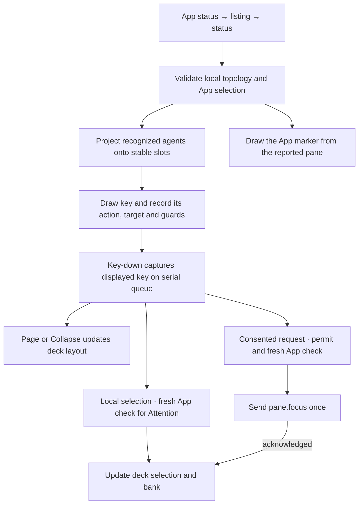

# Herdr App navigation on the Stream Deck MK.2

**Author** DeckShep Goldfish review  
**Status** Approved design  
**Approved** 2026-11-13

## Overview

A developer running Codex CLI and Claude Code in Herdr App should be able to glance at the deck, see which agent needs an answer and tap Attention to visit it. The experimental Herdr App profile will use the same first two rows as Rex. Herdr's own pane and status reports supply the information needed for navigation, even when provider hooks, Core readback and daemon access are off. [Reviewed concepts brief](../../concepts_brief.md)

## The Problem

The existing preview can display local terminals and request a pane change. An ordinary shell occupies a slot alongside agents, and Next follows the order of Herdr's latest listing. If Herdr reorders that listing, Next can change destinations while the tiles look the same. Someone looking for a waiting agent must scan the banks themselves. [Current controller](../../src/app/herdr-app-controller.ts)

The user also needs to know where a press took effect. When Herdr shows Codex and the user selects Claude locally, the current badge can follow the deck selection even though Herdr still reports Codex. The signed 0.1.14 private walkthrough established that tile and Next presses could request a pane change. A request acknowledgement alone does not establish which pane Herdr now shows or which process owns the keyboard. [Private walkthrough](../validation/2026-11-08-herdr-app-release-calibration.md)

## Goals

| Position | Default behavior |
| --- | --- |
| Row 1, keys 1–5 | Show five slots per bank for local panes Herdr identifies as Codex or Claude. Keep each agent in place when the listing reorders. Show unknown when a recognized agent has no known status. A selected ordinary shell must still allow the agent roster to appear. |
| Row 2, key 1 · Next | With at least two agents, visit the next live agent in stable slot order across all banks. Reveal the destination bank. |
| Row 2, key 2 · Page | With multiple banks, show the next bank. Changing the visible bank is a deck-local operation. |
| Row 2, key 3 · Collapse | When ended agents leave gaps, let the user compact the slots. |
| Row 2, keys 4–5 | Leave key 4 empty. Show Attention on key 5 when another agent is waiting, errored or done, in that priority order. Break ties by slot order across all banks. |

A press acts on the agent displayed at key-down. Immediately before applying an Attention selection locally or sending its focus request, DeckShep checks that the same agent still qualifies. If it has recovered, refuse with “Press again.” A newly waiting agent gets its own press. Existing stale-press, consent and single-use delivery guards still apply.

The deck identifies its local selection separately from the pane Herdr reports as selected. Focus requests require explicit consent, off by default, and a verified App peer and build. An acknowledgement shows “Focus requested.” A subsequent App observation determines where the App marker belongs. A lost reply after dispatch shows uncertainty and causes no retry.

## Non-Goals

This milestone covers tap navigation for local agents in the experimental App profile. Backward holds, remote panes and public packaging are outside its scope. Existing profile identities and saved key overrides must survive the layout change. A saved provider action stays inactive without the evidence that action requires.

Provider settings, turn controls, composer actions and approvals are later milestones. In particular, settings writes require proof that the displayed App pane belongs to the configured Core. A terminal address such as `t7` can exist on two cores. Neither selecting the pane nor successfully visiting it supplies that proof. [App and Core identity review](../adr/0007-herdr-app-0.1.14-source-review.md)

## Critical user journey

Herdr reports Codex working on the first bank and Claude waiting on the second. The user presses Attention while the deck shows Codex. With focus consent off, the deck opens Claude's bank, marks Claude locally and sends zero App focus requests. Returning to the first bank still shows the App marker on Codex while Herdr reports it there.

On a matched private preview with consent enabled, the same press requests Claude's pane once. The App marker moves to Claude only after Herdr reports Claude selected. If Claude becomes ready before dispatch, the press sends zero requests and leaves the selection in place, even if another agent has started waiting. These outcomes are acceptance criteria for the proposed design.

## Technical Plan

The Herdr App controller already owns observation, slots, the displayed bank and the press queue integration. Keep those responsibilities there. Share Rex's navigation row and Attention ranking through the domain layer. Herdr App keeps its own pane references and existing focus sender throughout the press.

### Herdr App, the Core CLI and the Core API

| Interface | What it can answer | Use in navigation |
| --- | --- | --- |
| Herdr App control socket | Which panes this App window shows, its reported selection and whether an overlay is open. The App also accepts a request to focus a named pane. | Use App `status` and `ls` for the agent roster, Attention and the App selection badge. Send `pane.focus` through the existing guarded sender when the user enables focus requests. |
| Herdr Core CLI (`hc`) | `hc ls` lists live terminals, `hc get` shows a terminal record, `hc events` follows changes and `hc schema` describes the protocol. A terminal can outlive its viewer. | Useful for understanding terminal records and inspecting the protocol during development. Spawning the CLI on each poll or press would duplicate the existing Core client and still leave the desktop window's selection unresolved. |
| Herdr Core socket API | DeckShep already uses `hello`, `server.status`, `terminal.list` and `terminal.get` on a configured Core connection. Core records can carry a program-reported title and state. | The existing optional readback can enrich a tile's label when App and Core facts agree. App-reported facts determine roster membership and Attention eligibility even when readback is off or fails. Core events alone cannot establish that a desktop pane still qualifies at key-down or dispatch. |

Core's shared layout document can describe panes across clients. The reviewed protocol gives each App window its own selection. A Core handshake identifies the Core that answered DeckShep, while establishing which Core the selected App window uses remains a prerequisite for later provider writes. The `hc` CLI and a direct API client face the same ambiguity if two cores both expose `t7`. The first navigation fixture therefore runs with Core unconfigured and expects zero Core calls. [Upstream Core CLI and status documentation](https://github.com/herdrdev/herdr-core/blob/3965a46caae095a3ead01de237fa13955e52b8c6/README.md) · [DeckShep Core client](../../src/terminals/herdr-app/transport.ts) · [Core readback](../../src/terminals/herdr-app/core-status.ts) · [App and Core protocol review](../adr/0007-herdr-app-0.1.14-source-review.md)

### From an App observation to the deck

1. **Read the whole view once.** Keep the existing bounded sequence of status, listing and status reads. Validate the active space, tab, selected pane, overlays and endpoint generation before filtering. A selected local shell can validate successfully even though it has no agent tile. Failure invalidates the observation and disarms navigation. [Selection reader](../../src/terminals/herdr-app/selection.ts)
2. **Use one roster for drawing and navigation.** In the App controller, reconcile recognized local Codex and Claude panes against the existing slot list using all four fields of `AppPaneRef` (space, tab, pane and terminal). Reuse each surviving slot, append newly discovered agents and retain gaps until Collapse. Use the App's reported provider and state for navigation eligibility. Missing status produces an unknown tile and no Attention candidate. Record the App's selected pane separately, even if it falls outside the roster. Invalidate outstanding presentations when the observation source or instance changes. [App types](../../src/domain/app-selection.ts) · [App controller](../../src/app/herdr-app-controller.ts)
3. **Resolve each key once for the frame.** Extract the existing five row-two action IDs from the Rex layout into a shared domain table. Apply explicit key overrides before checking action availability. Next walks occupied slots in order and wraps across banks. If navigation starts on a shell with no deck selection, Next starts at the first live agent. Page cycles through banks, including banks with retained gaps. Collapse removes gaps, preserves surviving order and clamps the current bank. For Attention, pass all slots, including gaps, to `attentionCandidates`. Exclude the live deck selection, falling back to the App selection when there is no local choice. Draw the winning agent and reason from the same result used to record the press target. [Layout](../../src/domain/layout.ts) · [Ranking](../../src/domain/navigation.ts) · [App view](../../src/app/herdr-app-view.ts)

### From key-down to selection

Extend `AppPresentation` with the displayed provider and, for Attention, the displayed reason (`waiting`, `error` or `done`). Record the selection used to rank the roster, the App-reported selection, and whether the displayed action offered local selection or a focus request. Keep the existing target, appearance, visibility, configuration, generation, arming time and stamp. Capture that presentation and press time at key-down. At execution, compare it with current state. A press whose consent or delivery mode changed expires, even if the new mode would permit a different action. [Host event handling](../../src/app/controller.ts) · [App presentation](../../src/app/herdr-app-view.ts)

| Action shown at key-down | Work on the existing queue |
| --- | --- |
| Page or Collapse | Validate the captured layout and update the bank or slots locally. Neither action selects a pane. |
| Local tile or Next | Recheck the presentation and resolve the captured target in the current live slots. Update the deck selection and reveal its bank. |
| Local Attention | Obtain one fresh observation from the same source. After the await, recheck the presentation, source identity, endpoint generation and timing. Require the exact captured pane, provider, selection context and Attention reason to still match. Only then update the deck selection and bank. |
| Tile, Next or Attention offering App focus | Issue the existing single-use App focus permit for the captured target. The sender verifies the command and already takes a fresh observation before dispatch. Use that observation to match the pane and provider. For Attention, apply the same selection and reason check as the local path. Consume the permit at the existing socket write. |

Use a pure comparison in the domain layer for the fresh target check so both Attention paths agree. Carry the displayed action and its target conditions in `AppFocusContext` and include them in the authority's identity comparison. The lease already carries the context to the sender, so the App socket payload stays `pane.focus` with the captured pane ID. The sender needs no access to the controller or to a provider. Preserve the 350 ms arming delay, the queue's stale-press limit and the focus authority's stricter one-second expiry. Recheck time and visibility after an asynchronous observation. [Focus contract](../../src/domain/app-focus-request.ts) · [Permit authority](../../src/guards/app-focus-request.ts) · [Focus sender](../../src/terminals/herdr-app/focus-sender.ts)

If the target disappears, becomes ready, changes provider, or ceases to match the displayed reason, leave the bank and selections untouched and show **Press again**. Preserve this outcome through the sender, which currently folds pre-dispatch errors into a generic refusal. An invalid peer or build still refuses the request. Once the write may have happened, a lost reply or failed postflight produces **Focus uncertain** with no retry. Herdr exposes the observation and focus request as separate operations, so the pane can change between them. The acknowledgement establishes only that the App accepted the request.

### What the user sees after a press

On local success or an acknowledged request, reveal the chosen bank and mark the deck's selection. Draw the App badge exclusively from the most recent validated App observation. For example, after a request for Claude, the deck can mark Claude locally while Herdr still reports Codex. A later observation moves the App badge. If the user changes panes in Herdr, retain the controller's behavior of clearing the previous local navigation choice when the reported selection changes. A press result never supplies a keyboard-focus or provider-input permit. [Selection and rendering](../../src/app/herdr-app-controller.ts) · [Tile drawing](../../src/app/herdr-app-view.ts)

Build the roster and its navigation results once per observation or local layout change. Reuse those results for all visible keys. Reuse the sender's observation for the consented Attention check. The inspector should report the count of recognized agents from that same roster and distinguish a successful read from a verified focus peer. Keep pane names and local paths out of diagnostics. [Inspector](../../src/app/herdr-app-inspector.ts)

### Compatibility and evidence

The change is internal to the experimental profile. Generated keys already store their profile scope, so the new defaults need no new key IDs or settings migration. An explicit override keeps its stored action string and passes the same availability checks as a default key. At both mapping and dispatch, App provider writes require the separate App-to-Core proof described in the brief, including for old settings overrides. The navigation milestone supplies no such proof. [Profile generation](../../scripts/profiles.mjs) · [Persisted identities](../IDENTITY.md)

The fixture acceptance case starts with six recognized agents, a selected shell, a gap and a waiting agent on the second bank. Reorder the listing and check that Next still follows the displayed slots. Change the Attention target to ready during its preflight and check for zero selection changes and zero focus writes. Exercise the same press with consent off, with a verified sender, with consent revoked while queued and with a lost reply after dispatch. Count App reads and focus requests independently. A later App observation determines the badge in every case. [Controller fixtures](../../tests/integration/herdr-app-controller.test.js) · [Focus contract fixtures](../../tests/contract/herdr-app-focus.test.js) · [Virtual deck](../../tests/e2e/herdr-app.spec.ts)

## Alternatives Considered

The first five options below come from the [reviewed concepts brief](../../concepts_brief.md#alternatives-weighed). The sixth records the Core CLI and API choice from the approved technical plan.

| Alternative | What it offers | Decision |
| --- | --- | --- |
| Keep the preview's pane roster and key positions | Existing preview users could keep their muscle memory and visit ordinary shells from the deck. | Rejected by author: shells would occupy agent slots, and switching between Rex and Herdr would move Next, Page and Collapse to different keys. Use Rex's default positions, list recognized local agents and preserve explicit overrides. |
| Re-rank Attention when the press executes | A queued press could follow a newly urgent agent. | Rejected by author: if Claude recovers while Codex starts waiting, pressing Attention while it shows Claude could visit Codex. Recheck the captured target and reason. Accept an occasional second press so the user sees the new destination before choosing it. |
| Wait for all provider controls before delivering navigation | A single milestone would offer navigation, settings and input together. | Rejected by author: finding and visiting a waiting agent already has an independent acceptance check. Waiting would tie that workflow to unresolved questions about Core identity, the composer and keyboard ownership. |
| Bind an App pane to Core by matching address, name, state and directory | These fields are available today and can help label a tile. | Rejected by author: two cores can each contain a ready Codex terminal named `t7` in the same directory. A valid chat lookup on the wrong core can therefore pass every comparison. Provider writes require evidence of the App's active Core connection that expires on reconnect. |
| Implement Rex controls with Core send, keys and interrupt | The Core API already exposes operations for submitting text, sending keys and interrupting a terminal. | Rejected by author: submitting text cannot preserve Steer and Queue semantics for an existing draft. An interrupt identifies a terminal but does not bind the press to a particular turn or background task. Sending Enter after a dialog changes could accept a different request. Evaluate each later control against its own target and state. |
| Drive navigation from `hc` listings or Core API events | Both expose terminal state. The API can supply updates without starting a CLI process per refresh. | Rejected by author as the navigation source: a live terminal can outlast its viewer, and its record alone cannot identify the pane selected in this App window. Use App observations for navigation and its selection badge. Keep `hc` for inspection and the existing optional Core reader for display details. |

## Detailed Implementation Plan

Implement the following steps in order. File links identify the proposed edits. The only new source file is the pure App navigation module in step 1.

1. **Define the roster and key order.** In [layout.ts](../../src/domain/layout.ts), export the five navigation actions already used by Rex and have both layouts consume that order. Create `src/domain/app-navigation.ts` beside [app-selection.ts](../../src/domain/app-selection.ts), which already defines the full pane reference and validated snapshot. Move pane equality/keying and reported-provider normalization out of the view into the new module. Accept an already validated snapshot, previous slots, current bank and deck choice. Return occupied slots and gaps, total banks, the effective navigation selection, Next's target and the ranked Attention candidates. Use the existing [attentionCandidates](../../src/domain/navigation.ts) with gaps represented at their physical indices. Compute Next over the same slot sequence, skipping gaps and wrapping. Default to bank zero for an empty roster. A closed slot remains a gap until Collapse or the same pane reference returns within the same instance. When the instance changes, discard previous slots and invalidate every captured target. Validate the complete App view in the existing reader before applying this projection, including when the selected pane is a shell.

2. **Describe the press that the user saw.** Extend [app-focus-request.ts](../../src/domain/app-focus-request.ts) with typed conditions for the displayed tile, Next or Attention. Include the pane reference, reported provider, App selection and effective navigation selection used for that presentation. Attention additionally requires its displayed reason. Use the existing focus permit solely for the focus-request branch. In [app-focus-request.ts (guard)](../../src/guards/app-focus-request.ts), validate the conditions, include them in the current-context comparison, clone on issue and protect nested references on the lease. Reject missing conditions, invalid combinations and changed identities before consuming a permit. Preserve the existing one-use lifecycle and peer, build and endpoint checks.

3. **Project the same result onto keys and presses.** In [herdr-app-controller.ts](../../src/app/herdr-app-controller.ts), reconcile slots once after each accepted observation. Recompute navigation when the roster, bank or selection changes. Keep the App-selected pane from the snapshot separate from the deck's explicit choice. In [herdr-app-view.ts](../../src/app/herdr-app-view.ts), make the resolved action and target the inputs to both the tile and its presentation. Apply saved overrides first, then the action's eligibility rules. Hide Next with fewer than two live agents, Page with one bank, Collapse with no gap and Attention with no candidate. Display the target and reason on Attention, a state shape on agent tiles and the App badge only on the observed App selection. Keep `Deck selected` tied to the local choice. Use existing caption sizing and feedback limits. If an explicit override is unavailable, leave the key inert instead of falling back to its default action.

4. **Publish frames and capture presses through the host.** In [controller.ts](../../src/app/controller.ts), pass the existing frame cache and queue age limit into the App controller. Produce complete `KeySpec` values from the App view for the existing cache. Compute the presentation stamp once per render from the guard-relevant state, and update each presentation even if its pixels are unchanged. Compare the spec key before SVG encoding and host emission. Keep key-down capture ahead of enqueueing and App gestures tap-only. Check appearance, visibility, setup, configuration, stamp, offered delivery mode, arming time and queue age before applying an App action. Use the snapshot's endpoint generation and the actual observation source for the local path, including when the verified focus port is absent. Recheck after any awaited read. Use the focus authority's shorter expiry for a focus request. A queued request cannot turn into a local selection after consent is revoked.

5. **Make Attention's last check part of delivery.** In the new domain module, compare the fresh observation with the captured conditions. Require exactly one matching full pane reference, the same reported provider, and for Attention the same qualifying reason and selection context. Never substitute a newly ranked candidate. In the App controller, use the active observer's bounded read for local Attention, under the same controller generation. Finish all checks before changing the bank or deck selection. In [focus-sender.ts](../../src/terminals/herdr-app/focus-sender.ts), use the observation already taken after the command check and before the socket write. Preserve a distinct stale-target outcome through the existing catch so the controller can display `Press again`. A peer/build failure before the write remains a refusal. Once a write may have happened, report `Focus uncertain` on failure and issue no second request. An acknowledgement updates the deck choice and bank. Only the regular observation path may update the App badge. The wire request remains a single `pane.focus`.

6. **Close the existing settings route in this milestone.** The App controller currently admits Model, Effort and Permissions when consent, readiness and Core labels agree. The approved design requires a verified App-to-Core binding, which this milestone cannot supply. Return no eligible provider writes from App mapping and refuse such an action at dispatch before calling the daemon adapter, even for an older captured presentation or saved override. Preserve the stored action string and preference values. Keep readback available for optional display details. This change belongs in [herdr-app-controller.ts](../../src/app/herdr-app-controller.ts). The provider's underlying settings operations remain available for future work on binding.

7. **Make inspector feedback match the deck.** Pass the recognised-agent count, provider counts, observation availability and verified peer/build match separately from the controller. Update [herdr-app-inspector.ts](../../src/app/herdr-app-inspector.ts) to report focus availability from consent and the verified port. Update [herdr-app-diagnostics.ts](../../src/app/herdr-app-diagnostics.ts) to distinguish a successful read from a matched peer. The passive CLI doctor can continue to report an unknown runtime match. In [inspector source](../../src/inspector/index.ts) and [inspector markup](../../com.kotl3r.deckshep.sdPlugin/inspector.html), show agent counts, local selection and focus-request availability, and correct the claim that this milestone can change Codex settings. Preserve saved preferences and the 160-character message limit. Generate the inspector bundle through the normal build.

8. **Exercise the permit with realistic fixtures.** In [herdr-app-focus.js](../../tests/helpers/herdr-app-focus.js), populate the full displayed conditions. In [app-focus-guard.test.js](../../tests/unit/app-focus-guard.test.js), vary one condition at a time, including a reason change with the same target, and require refusal without permit reuse. In [herdr-app-focus.test.js](../../tests/contract/herdr-app-focus.test.js), vary the listing returned during the sender's existing preflight. Count the actual socket writes. Preserve the isolated calibration callers in [scenarios.cjs](../../tests/live/app-calibration/scenarios.cjs) and [release-scenarios.cjs](../../tests/live/app-calibration/release-scenarios.cjs) by capturing the observed pane and selection when arming their plain requests. Their test-owned panes can have a null reported provider. Capture and compare that observed value explicitly. The product roster admits only recognized agents, and missing evidence must never act as a wildcard. Exercise harness compatibility through the existing fixture suite.

9. **Cover controller, rendering and upgrade behavior.** Extend [herdr-app-view.test.js](../../tests/unit/herdr-app-view.test.js) with the shared row order, conditional visibility, unknown state, bank crossing and independent markers. Use [app-controller-backend.js](../../tests/helpers/app-controller-backend.js) for controlled changes to the App observation and counts of reads and writes. In [herdr-app-controller.test.js](../../tests/integration/herdr-app-controller.test.js), exercise the matrix below with real host events and the fixture backend. Inject counters around SVG drawing and host frames. In [herdr-app-daemon-controls.test.js](../../tests/integration/herdr-app-daemon-controls.test.js), replace the expectation that matching labels allow a settings write with assertions that explicit Model, Effort and Permissions overrides each make zero daemon calls, including with all prior opt-ins set. In [herdr-app-setup.test.js](../../tests/integration/herdr-app-setup.test.js) and [inspector.test.js](../../tests/integration/inspector.test.js), check status and doctor messages in observer-only and verified modes. Extend [preferences.test.js](../../tests/integration/preferences.test.js) to deliver the existing explicit v2 rollback projection via the host settings event and compare shared, Rex and Herdr TUI values. Verify that no App consent transfers. Exercise a saved override independently through the per-key settings event.

10. **Exercise the public user interface in the virtual deck.** In [app-focus.ts](../../tests/e2e/virtual-host/app-focus.ts), apply the fresh-target comparison after the fixture pause and before recording a focus request. Keep acknowledgement independent of simulated App selection. Update [herdr-app.spec.ts](../../tests/e2e/herdr-app.spec.ts) for the Rex key positions. Supply the mixed six-agent scenario through the existing scenario-object interface. Exercise the Attention journey, including the off-bank target, later observed selection, stale press and lost consent. In [inspector.spec.ts](../../tests/e2e/inspector.spec.ts), update the agent-count expectation and check the meaning of the focus indicator. Update the [virtual deck guide](../../tests/e2e/README.md) with the scenario and expected trace. Existing Rex and Herdr TUI screenshots and golden contracts provide regression coverage for the shared layout.

11. **Document the preview and verify the change.** Update [Herdr App setup](../HERDR-APP.md) for navigation with and without Core readback and focus consent, and [the profile map](../PROFILES.md) for Attention, local banking, gaps and tap-only gestures. Update [AGENTS.md](../../AGENTS.md) to identify the App-specific observation source, shared row layout and provider-write boundary. Keep the dated private walkthrough as evidence about its original build. Run the checks below against the implemented change and record actual results in the PR.

### Acceptance and verification

| Fixture condition | Required observation |
| --- | --- |
| A shell is selected, six recognized agents span two banks, one agent has unknown status, and the App reorders its listing | The shell occupies no tile. Unknown remains visible. Stable slots determine Next and Attention order. Ties use slot order, including beyond the current bank. Removing a pane creates a gap, and Collapse preserves the surviving order. |
| Claude is waiting on the other bank, with focus consent off and Core unconfigured | One fresh local Attention observation. The deck reveals Claude with zero focus requests, provider calls or Core calls. The App badge continues to represent the observed selection. Page and Collapse make zero App requests. |
| Same journey with a verified focus port and consent on | From the press, count one command check, one status/listing/status observation and one focus write naming Claude. An acknowledgement alone leaves the App badge on its previously observed pane. A later independent observation moves the badge. |
| Claude becomes ready or changes provider/reason during preflight, or another pane becomes the best candidate while Claude ceases to qualify | Local and focus paths refuse the stale target with `Press again`. Zero focus writes and no local selection or bank change. A new render can offer the other target. |
| Key disappears, settings change, endpoint reconnects, consent is revoked, a press predates arming, or the queue/permit deadline expires | At each relevant boundary the captured press fails before its effect. Exercise revocation during an awaited read and just before the write. An ambiguous post-write outcome has one attempted write, zero retries and no assertion of keyboard focus. |
| A saved settings override points at a ready Codex pane while a different Core exposes the same address | Override survives settings round-trip. Zero daemon writes, terminal input or newly enabled consent. A later design must demonstrate the positive binding case before restoring writes. |
| A stable deck ticks after warm-up, then a pane closes and a notice expires | Zero additional SVG builds and zero image frames on unchanged ticks. Changed faces redraw when needed. Count the App reads separately from frames and repeat after multiple closures and Collapse. |

Start with the named unit, contract and integration fixtures using `node --import tsx --test`. Then run `npm run typecheck`, `npm run deps`, `npm run lint`, `npm run format:check`, `npm run test:golden` and `npm run test:coverage` with the repository thresholds. Build with `npm run build`, then run `npm run test:bundled` and `npm run test:e2e` on the supported macOS setup. Check release scope with the existing release-policy fixtures and `npm run package`. Expected visual changes are confined to the experimental App profile and its inspector. Review any unexpected golden or screenshot diff before changing a baseline. These checks establish fixture, build and browser behavior. Physical Attention behavior on a particular signed App build requires separate authorized validation.
