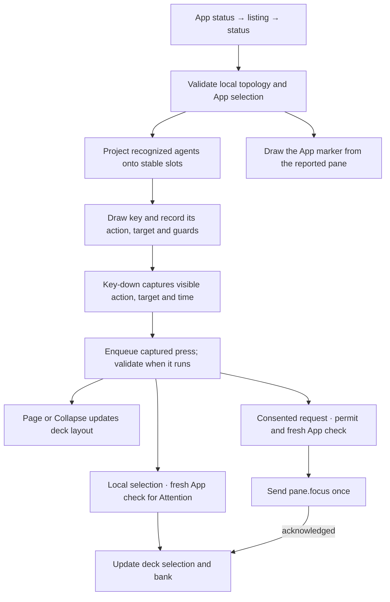

# Herdr App navigation on the Stream Deck MK.2

**Author** DeckShep Goldfish review  
**Status** Revised following the five-stage design review

**Original design approved** 2026-11-13 (commit `1b987fb`)

## Overview

A developer running Codex CLI and Claude Code in Herdr App should be able to glance at the deck, see which agent needs an answer and tap Attention to visit it. The experimental Herdr App profile will use the same first two rows as Rex. Herdr's own pane and status reports supply the information needed for navigation, even when provider hooks, Core readback and daemon access are off. [Reviewed concepts brief](../../concepts_brief.md)

## The Problem

The existing preview can display local terminals and request a pane change. An ordinary shell occupies a slot alongside agents, and Next follows the order of Herdr's latest listing. If Herdr reorders that listing, Next can change destinations while the tiles look the same. Someone looking for a waiting agent must scan the banks themselves. [Current controller](../../src/app/herdr-app-controller.ts)

The user also needs to know where a press took effect. When Herdr shows Codex and the user selects Claude locally, the current badge can follow the deck selection even though Herdr still reports Codex. The owner reported seeing tile and Next presses change panes in the private walkthrough on signed App 0.1.14. The separate instrumented calibration recorded focus requests. A request acknowledgement alone does not establish which pane Herdr now shows or which process owns the keyboard. [Private walkthrough](../validation/2026-11-08-herdr-app-release-calibration.md)

## Goals

| Position | Default behavior |
| --- | --- |
| Row 1, keys 1–5 | Show five slots per bank for local panes Herdr identifies as Codex or Claude. Keep each agent in place when the listing reorders. Show unknown when a recognized agent has no known status. A selected ordinary shell must still allow the agent roster to appear. |
| Row 2, key 1 · Next | With at least two agents, visit the next live agent in stable slot order across all banks. Reveal the destination bank. |
| Row 2, key 2 · Page | With multiple banks, show the next bank. Changing the visible bank is a deck-local operation. |
| Row 2, key 3 · Collapse | When removed panes leave gaps, let the user compact the slots. |
| Row 2, keys 4–5 | Map key 4 to `none` (empty). Show Attention on key 5 when another agent is waiting, errored or done, in that priority order. Break ties by slot order across all banks. |

A press identifies the displayed App pane by space, tab, pane and terminal, plus its reported provider. Attention also requires the same reported reason at its fresh check. A listed pane reporting done still qualifies. A process that restarts and reports identical facts in a retained pane is indistinguishable to navigation. If it has recovered, refuse with “Press again.” A newly waiting agent gets its own press. Existing stale-press, consent and single-use delivery guards still apply.

The deck identifies its local selection separately from the pane Herdr reports as selected. Focus requests require explicit consent, off by default, and a verified App peer and build. After acknowledgement, an agent tile retains its name and status and shows “On deck.” Attention immediately shows the next eligible destination or clears. A subsequent App observation determines where the App marker belongs. A lost reply after dispatch shows uncertainty and causes no retry.

## Non-Goals

This milestone covers tap navigation for local agents in the experimental App profile. Backward holds, remote panes and public packaging are outside its scope. Existing profile identities and saved key overrides must survive the layout change. On upgrade, the existing experimental Model, Effort and Permissions keys become inactive, including saved overrides with all former opt-ins enabled. Their saved action strings and preferences survive. Restoring writes requires proof of the App’s active Core connection.

Provider settings, turn controls, composer actions and approvals are later milestones. In particular, settings writes require proof that the displayed App pane belongs to the configured Core. A terminal address such as `t7` can exist on two cores. Neither selecting the pane nor successfully visiting it supplies that proof. [App and Core identity review](../adr/0007-herdr-app-0.1.14-source-review.md)

## Critical user journey

Herdr reports Codex working on the first bank and Claude waiting on the second. The user presses Attention while the deck shows Codex. With focus consent off, the deck opens Claude's bank, marks Claude locally and sends zero App focus requests. Returning to the first bank still shows the App marker on Codex while Herdr reports it there.

On a matched private preview with consent enabled, the same press requests Claude's pane once. The App marker moves to Claude only after Herdr reports Claude selected. If Claude becomes ready before dispatch, the press sends zero requests and leaves the selection in place, even if another agent has started waiting. These outcomes are acceptance criteria for the proposed design.

## Technical Plan

The Herdr App controller already owns observation, slots, the displayed bank and the press queue integration. Keep those responsibilities there. Share Rex's navigation row and Attention ranking through the domain layer. Herdr App keeps its own pane references and existing focus sender throughout the press.

### Herdr App, the Core CLI and the Core API

| Interface | What it can answer | Use in navigation |
| --- | --- | --- |
| Herdr App control socket | Which panes this App window shows, its reported selection and whether an overlay is open. The App also accepts a request to focus a named pane. | Use App `status` and `ls` for the agent roster, Attention and the App selection badge. Send `pane.focus` through the existing guarded sender when the user enables focus requests. |
| Herdr Core CLI (`hc`) | `hc ls` lists live terminals, `hc get` shows a terminal record, `hc events` follows changes and `hc schema` describes the protocol. A terminal can outlive its viewer. | Useful for understanding terminal records and inspecting the protocol during development. Spawning the CLI on each poll or press would duplicate the existing Core client and still leave the desktop window's selection unresolved. |
| Herdr Core socket API | DeckShep already uses `hello`, `server.status`, `terminal.list` and `terminal.get` on a configured Core connection. Core records can carry a program-reported title and state. | Optional readback can provide separately attributed Core information. Every actionable destination uses the App pane name, falling back to the App-reported provider. Core titles, names and state cannot override the navigation face. App-reported facts determine roster membership and Attention eligibility even when readback is off or fails. Core events alone cannot establish that a desktop pane still qualifies at key-down or dispatch. |

Core's shared layout document can describe panes across clients. The reviewed protocol gives each App window its own selection. A Core handshake identifies the Core that answered DeckShep, while establishing which Core the selected App window uses remains a prerequisite for later provider writes. The `hc` CLI and a direct API client face the same ambiguity if two cores both expose `t7`. The first navigation fixture therefore runs with Core unconfigured and expects zero Core calls. [Upstream Core CLI and status documentation](https://github.com/herdrdev/herdr-core/blob/3965a46caae095a3ead01de237fa13955e52b8c6/README.md) · [DeckShep Core client](../../src/terminals/herdr-app/transport.ts) · [Core readback](../../src/terminals/herdr-app/core-status.ts) · [App and Core protocol review](../adr/0007-herdr-app-0.1.14-source-review.md)

### From an App observation to the deck

1. **Read the whole view once.** Keep the existing bounded sequence of status, listing and status reads. Validate the active space, tab, selected pane, overlays and endpoint generation before filtering. A selected local shell can validate successfully even though it has no agent tile. Failure invalidates the observation and disarms navigation. [Selection reader](../../src/terminals/herdr-app/selection.ts)
2. **Use one roster for drawing and navigation.** In the App controller, reconcile recognized local Codex and Claude panes against the existing slot list using all four fields of `AppPaneRef` (space, tab, pane and terminal). Reuse each surviving slot, append newly discovered agents and retain gaps until Collapse. Use the App's reported provider and state for navigation eligibility. A null status removes the agent from navigation even if the App retains its former provider name. An unfamiliar nonempty status produces an unknown tile and no Attention candidate. Record the App's selected pane separately, even if it falls outside the roster. Invalidate outstanding presentations when the observation source or instance changes. [App types](../../src/domain/app-selection.ts) · [App controller](../../src/app/herdr-app-controller.ts)
3. **Resolve each key once for the frame.** Share the five Rex positions in order: `next`, `banknext`, `collapse`, `none`, `attention`. Apply explicit key overrides before checking action availability. Next walks occupied slots in order and wraps across banks. If navigation starts on a shell with no deck selection, Next starts at the first live agent. Page cycles through banks, including banks with retained gaps. Collapse removes gaps, preserves surviving order and clamps the current bank. For Attention, pass all slots, including gaps, to `attentionCandidates`. Exclude the live deck selection, falling back to the App selection when there is no local choice. Draw the winning agent and reason from the same result used to record the press target. [Layout](../../src/domain/layout.ts) · [Ranking](../../src/domain/navigation.ts) · [App view](../../src/app/herdr-app-view.ts)

### From key-down to selection

Extend `AppPresentation` with the App-sourced destination name and displayed provider and, for Attention, the displayed reason (`waiting`, `error` or `done`). Record the selection used to rank the roster, the App-reported selection, and whether the displayed action offered local selection or a focus request. Keep the existing guard checks and replace the raw snapshot stamp with the per-key revision defined below. Capture that presentation and press time at key-down. At execution, compare it with current state. A press whose consent or delivery mode changed expires, even if the new mode would permit a different action. [Host event handling](../../src/app/controller.ts) · [App presentation](../../src/app/herdr-app-view.ts)

| Action shown at key-down | Work on the existing queue |
| --- | --- |
| Page or Collapse | Validate the captured layout and update the bank or slots locally. Neither action selects a pane. |
| Local tile or Next | Recheck the presentation and resolve the captured target in the current live slots. Update the deck selection and reveal its bank. |
| Local Attention | Obtain one fresh observation from the same source. After the await, recheck the presentation, source identity, endpoint generation and timing. Require the exact captured pane, provider, selection context and Attention reason to still match. Only then update the deck selection and bank. |
| Tile, Next or Attention offering App focus | Issue the existing single-use App focus permit for the captured target. The sender verifies the command and already takes a fresh observation before dispatch. Use that observation to match the pane and provider. For Attention, apply the same selection and reason check as the local path. Begin the permit once before preflight and consume its lease at the existing socket write. |

Use a pure comparison in the domain layer for the fresh target check so both Attention paths agree. Carry the displayed action and its target conditions in `AppFocusContext` and include them in the authority's identity comparison. The lease already carries the context to the sender, so the App socket payload stays `pane.focus` with the captured pane ID. The sender needs no access to the controller or to a provider. Preserve the 350 ms arming delay, the queue's stale-press limit and the focus authority's stricter one-second expiry. Recheck time and visibility after an asynchronous observation. [Focus contract](../../src/domain/app-focus-request.ts) · [Permit authority](../../src/guards/app-focus-request.ts) · [Focus sender](../../src/terminals/herdr-app/focus-sender.ts)

On a valid fresh view, refuse a missing pane or changed provider for every targeted action. A status-only change on the same tile or Next destination, including becoming ready, permits ordinary navigation. For Attention, a change or loss of the captured reason refuses the press. A stale press makes no selection or bank change of its own and shows **Press again**. Preserve this outcome through the sender, which currently folds pre-dispatch errors into a generic refusal. An invalid peer or build still refuses the request. Once the write may have happened, a lost reply or failed postflight produces **Focus uncertain** with no retry. Herdr exposes the observation and focus request as separate operations, so the pane can change between them. The acknowledgement establishes only that the App accepted the request.

### Observation ownership and recovery (A3, A4, A12)

The controller owns one active observation source and assigns it a monotonically increasing epoch. Store the actual reader object, epoch and its endpoint generation with every accepted snapshot. A different reader can also report generation 1. Compare all three before publishing a result or applying a captured action. On replacement, endpoint change, disposal or loss of provable continuity, invalidate outstanding presentations, revoke leases through the existing guard, clear the roster, slots, deck choice and App badge, and return to bank zero. Discard late results from the former epoch. Accept a new roster only from a complete successful observation.

At initialization or explicit inspector refresh, try the verified port if a record and helper are available. A missing or unmatched build can offer local navigation only after a newly opened read-only observer independently passes the endpoint safety checks and validates a complete view. Label this mode **Deck only**, even with consent on. An unsafe endpoint, ambiguous topology, overlay or unreadable view leaves navigation disarmed. While on the read-only source, use ordinary polls for observation; a configuration change or explicit refresh may retry verification. A verified source with consent off also offers local selection. Verification lost after key-down expires the captured focus press; it cannot trigger an observer fallback on behalf of that press. Rediscovery creates a new presentation and arming interval.

Serialize observations for timer, inspector and press on the active source. Track the in-flight poll promise, and pass the remaining deadline as an abort signal through the observer adapter, reader and focus sender. Reserve the reader for the dequeued press before waiting, coalesce timer refreshes while reserved, and let an already running poll finish and publish only if its source still matches. Do not await work queued behind the current press. Recheck the captured guards, then start the press's own post-key-down observation, including for the verified sender's preflight. Bound waiting and I/O by the original press deadline (local queue budget 2,000 ms; focus lease expires at 1,000 ms from key-down). A late completion cannot commit the expired press. Release the reservation on every exit; coalesced polling may then resume. A valid snapshot showing a changed candidate makes just the press stale and can refresh the roster. Failure to validate the view disarms **all** navigation immediately, including local tile and Next presses, until a new valid observation is accepted. A timeout while merely waiting on a healthy poll expires the press without asserting that the view is invalid.

### Visible action and arming (A1, A2, A5, A6, A9)

Resolve the visible face and its presentation together. Use the App-reported pane name, or the recognized provider if unnamed, on each actionable destination. Keep secondary Core details out of navigation faces. After a successful agent-tile request, retain its name, space folder basename and status with the On deck marker above the title. After a successful Next request, show the next destination immediately and arm it for the usual 350 ms. The acknowledged choice is visible on its agent tile. An error notice such as **Press again** publishes action `none` and no target. Keep the notice active across candidate changes within the same key appearance and source. A press during the notice cannot change selection or write to the App. On notice expiry, publish the newly visible destination and arm it for 350 ms from that render. A guard transition invalidates older captures even if their previous values later return.

Use a per-key presentation revision and arming time. Include appearance/visibility, source epoch and endpoint generation, configuration/consent, offered mode, verified peer and record when used, bank, resolved action/override and notice visibility. Derive action-specific inputs from the same stable-slot projection used for the face:

| Key | Additional facts whose change invalidates a capture |
| --- | --- |
| Tile | Displayed pane reference, provider and displayed destination name. A status-only update redraws its state without restarting ordinary navigation arming. |
| Next | Effective starting selection, App selection, live-agent threshold and resolved next destination (reference, provider and displayed name). |
| Attention | Both selections, candidate reference, App provider, displayed destination name and reason. A higher-ranked candidate changes the next presentation; a queued press can expire but cannot redirect. |
| Page / Collapse | Current bank and resulting bank or compacted ordered slots, including which positions are gaps. |

Build these values from stable slot order. Exclude raw listing order, time of observation and optional Core labels. Preserve the revision and arming deadline when these inputs compare equal. Keep a separate image-spec cache key so a harmless visual refresh cannot expire a valid press. At fresh preflight compare the target facts carried by the specific action; ordinary tile/Next accepts a changed status when its target and other guards still match.

### What the user sees after a press

On local success or an acknowledged request, reveal the chosen bank and mark the deck's selection. Draw the App badge exclusively from the most recent validated App observation. For example, after a request for Claude, the deck can mark Claude locally while Herdr still reports Codex. A later observation moves the App badge. On acknowledgement of a request for B while Herdr reports A, B has the deck marker and A the App badge. Repeated observations of A preserve this local choice. When a valid observation first changes the reported pane to B, clear the explicit deck choice and show only the App badge on B. If Herdr next reports C, show only the App badge on C. Apply this rule regardless of who initiated either change. A press result never supplies a keyboard-focus or provider-input permit. [Selection and rendering](../../src/app/herdr-app-controller.ts) · [Tile drawing](../../src/app/herdr-app-view.ts)

Build the roster and its navigation results once per observation or local layout change. Reuse those results for all visible keys. Reuse the sender's observation for the consented Attention check. The inspector should report the count of recognized agents from that same roster and distinguish a successful read from a verified focus peer. Keep pane names and local paths out of diagnostics. [Inspector](../../src/app/herdr-app-inspector.ts)

### Compatibility and evidence

The change is internal to the experimental profile. Generated keys already store their profile scope, so the new defaults need no new key IDs or settings migration. An explicit override keeps its stored action string and passes the same availability checks as a default key. At both mapping and dispatch, App provider writes require the separate App-to-Core proof described in the brief, including for old settings overrides. The navigation milestone supplies no such proof. [Profile generation](../../scripts/profiles.mjs) · [Persisted identities](../IDENTITY.md)

The fixture acceptance case starts with six recognized agents, a selected shell, a gap and a waiting agent on the second bank. Reorder the listing and check that Next still follows the displayed slots. Change the Attention target to ready during its preflight and check for zero selection changes and zero focus writes. Exercise the same press with consent off, with a verified sender, with consent revoked while queued and with a lost reply after dispatch. Count App reads and focus requests independently. A later App observation determines the badge in every case. [Controller fixtures](../../tests/integration/herdr-app-controller.test.js) · [Focus contract fixtures](../../tests/contract/herdr-app-focus.test.js) · [Virtual deck](../../tests/e2e/herdr-app.spec.ts)

## Alternatives Considered

These are DeckShep project decisions. The first five options below come from the [reviewed concepts brief](../../concepts_brief.md#alternatives-weighed). The sixth records the Core CLI and API choice from the approved technical plan.

| Alternative | What it offers | Decision |
| --- | --- | --- |
| Keep the preview's pane roster and key positions | Existing preview users could keep their muscle memory and visit ordinary shells from the deck. | Shells would occupy agent slots, and switching between Rex and Herdr would move Next, Page and Collapse to different keys. Use Rex's default positions, list recognized local agents and preserve explicit overrides. |
| Re-rank Attention when the press executes | A queued press could follow a newly urgent agent. | If Claude recovers while Codex starts waiting, pressing Attention while it shows Claude could visit Codex. Recheck the captured target and reason. Accept an occasional second press so the user sees the new destination before choosing it. |
| Wait for all provider controls before delivering navigation | A single milestone would offer navigation, settings and input together. | Finding and visiting a waiting agent already has an independent acceptance check. Waiting would tie that workflow to unresolved questions about Core identity, the composer and keyboard ownership. |
| Bind an App pane to Core by matching address, name, state and directory | These fields are available today and can help label a tile. | Two cores can each contain a ready Codex terminal named `t7` in the same directory. A valid chat lookup on the wrong core can therefore pass every comparison. Provider writes require evidence of the App's active Core connection that expires on reconnect. |
| Implement Rex controls with Core send, keys and interrupt | The Core API already exposes operations for submitting text, sending keys and interrupting a terminal. | Submitting text cannot preserve Steer and Queue semantics for an existing draft. An interrupt identifies a terminal but does not bind the press to a particular turn or background task. Sending Enter after a dialog changes could accept a different request. Evaluate each later control against its own target and state. |
| Drive navigation from `hc` listings or Core API events | Both expose terminal state. The API can supply updates without starting a CLI process per refresh. | A live terminal can outlast its viewer, and its record alone cannot identify the pane selected in this App window. Use App observations for navigation and its selection badge. Keep `hc` for inspection. Any optional Core detail shown outside navigation faces must identify Core as its source. |

## Detailed Implementation Plan

Land the following checkpoints in order (A16). Each checkpoint is one buildable change with its consumers and fixture expectations. Run `npm run typecheck` at every checkpoint, including the virtual host types. Commands below are planned checks against the implementation.

#### 1. Shared roster and settings boundary

Create `src/domain/app-navigation.ts` for pure pane equality, provider normalization, stable-slot reconciliation and action resolution over [App snapshots](../../src/domain/app-selection.ts). Extract the five positions in [layout.ts](../../src/domain/layout.ts) and reuse [Attention ranking](../../src/domain/navigation.ts). Index live panes and retained references by their four-field key, traverse the retained slots once and append previously unseen references. Collapse filters gaps, preserves live order and clamps the bank. Reconciliation costs O(P + S) time and space for P observed panes and S retained slots. Attention ranking separately costs up to O(K log K) for K eligible panes with the existing sort. S may grow with distinct retired panes until Collapse or a source reset. Avoid rescanning S for each pane or each key render. Measure map inserts/lookups and slot visits as well as draw counts under churn (A10).

Move all helper imports together in [the controller](../../src/app/herdr-app-controller.ts), [view](../../src/app/herdr-app-view.ts), [view tests](../../tests/unit/herdr-app-view.test.js) and [virtual host](../../tests/e2e/virtual-host/app-focus.ts). Exercise the pure projection with a shell, a done pane, unknown status, six agents, a gap, a listing reorder and a destination on another bank. Keep the new navigation mapping internal until checkpoint 3 wires both routes. In this checkpoint return no eligible App settings writes at mapping or dispatch, including old captures and explicit overrides. Preserve stored settings. Update [daemon control fixtures](../../tests/integration/herdr-app-daemon-controls.test.js) in the same change, including same-address sessions and old opt-ins. Verify with `node --import tsx --test tests/unit/herdr-app-view.test.js tests/unit/attention.test.js tests/integration/herdr-app-daemon-controls.test.js`.

#### 2. Focus contract, source lifetime and guarded delivery

Update [AppFocusContext](../../src/domain/app-focus-request.ts), [permit authority](../../src/guards/app-focus-request.ts), [sender](../../src/terminals/herdr-app/focus-sender.ts), controller state producers and the virtual sender in one change. Carry the full displayed target, conditions, source identity token and original press time. Compare immutable copies of the action-specific conditions. The controller associates the serializable epoch with its active reader object. In [host composition](../../src/app/controller.ts) and the App controller, coordinate polls, preflight and recovery as specified above. Propagate bounded deadlines and distinguish stale target, invalid view, failed verification, and an uncertain mutation. Keep the wire payload unchanged.

**Permit lifecycle (A15).** `issue` records a one-use permit. `begin` removes it before validating the lease; a preflight failure burns that press. `lease.consume` checks the current context, peer, record and generation immediately at the socket write. Reusing a burned permit fails even if state recovers. The only mutation is one attempted `pane.focus`; every path after a possibly dispatched write has zero retries.

**Calibration evidence (A14).** Product tiles require an App-reported recognized provider. The plain-pane calibration route captures the required raw nullable provider field. For a captured null, compare explicitly to a present raw null before any provider normalization. For a captured string require the same raw string in calibration. Unknown strings cannot stand in for null. Missing fields fail boundary validation; do not coerce undefined. Update all producers together: [focus fixtures](../../tests/helpers/herdr-app-focus.js), [source calibration scenarios](../../tests/live/app-calibration/scenarios.cjs), and [release calibration scenarios](../../tests/live/app-calibration/release-scenarios.cjs). Use existing validated pane observations in those harnesses. Exercise null→null, null→unknown string and missing-field cases with private fixtures.

In [guard tests](../../tests/unit/app-focus-guard.test.js) and [focus contract tests](../../tests/contract/herdr-app-focus.test.js), check each guard transition and failed replay. In [controller backend fixtures](../../tests/helpers/app-controller-backend.js) and [controller tests](../../tests/integration/herdr-app-controller.test.js), control poll completion, reader replacement and read failures deterministically. Verify with `node --import tsx --test tests/unit/app-focus-guard.test.js tests/contract/herdr-app-focus.test.js tests/integration/herdr-app-controller.test.js tests/integration/herdr-app-calibration.test.js`. Calibration scenarios are verified here through synthetic fixtures.

#### 3. Enable navigation and render the actual presentation

Together update host composition, App controller, App view and virtual host to use the shared roster, both selection markers, per-key revisions, stable arming and inert notices. Build a complete `KeySpec` using the existing frame cache. Publish a presentation even if the image is cached. Update the prior controller/view/daemon fixture coordinate assertions in this change. In [virtual deck scenarios and checks](../../tests/e2e/herdr-app.spec.ts), use the existing scenario-object interface. After a simulated pause the virtual sender must check the same conditions before recording dispatch. Its acknowledgement must leave the App selection unchanged until an independent fixture observation. Verify with `node --import tsx --test tests/unit/herdr-app-view.test.js tests/integration/herdr-app-controller.test.js tests/integration/herdr-app-daemon-controls.test.js` and `npm run test:e2e -- tests/e2e/herdr-app.spec.ts`.

#### 4. Inspector, upgrade path and documentation

Pass recognized counts, observation availability and verified peer/build match separately to [the inspector](../../src/app/herdr-app-inspector.ts) and [diagnostics](../../src/app/herdr-app-diagnostics.ts). In [inspector source](../../src/inspector/index.ts) and [markup](../../com.kotl3r.deckshep.sdPlugin/inspector.html), expose both `attention` and the empty-string “Position default” option in App scope. Retain `none` as a distinct explicit blank override. A change emits `setSettings` with the existing scope, other key settings and the selected action. Refresh displays the stored choice. Action visibility on the deck still depends on eligibility (A13). Describe the three disabled provider controls in the upgrade text (A8).

Use [setup](../../tests/integration/herdr-app-setup.test.js), [inspector integration](../../tests/integration/inspector.test.js) and [browser inspector](../../tests/e2e/inspector.spec.ts) fixtures to check counts, observer-only messaging and actual selector events. In [preferences fixtures](../../tests/integration/preferences.test.js), pass the existing explicit v2 rollback projection through the synthetic host event and compare shared, Rex and Herdr TUI values, including consent isolation. Update the [App guide](../HERDR-APP.md), [profile map](../PROFILES.md), [virtual deck guide](../../tests/e2e/README.md) and [standing instructions](../../AGENTS.md). Build the inspector from source. Verify with `node --import tsx --test tests/integration/herdr-app-setup.test.js tests/integration/inspector.test.js tests/integration/preferences.test.js` and `npm run test:e2e -- tests/e2e/inspector.spec.ts`, then run the repository checks below.

### Acceptance and verification

| Fixture condition | Required observation |
| --- | --- |
| A shell is selected, six recognized agents span two banks, one agent has unknown status, and the App reorders its listing | The shell occupies no tile. Unknown remains visible. Stable slots determine Next and Attention order. Ties use slot order, including beyond the current bank. Removing a pane creates a gap, and Collapse preserves the surviving order. |
| Claude is waiting on the other bank, with focus consent off and Core unconfigured | One fresh local Attention observation. The deck reveals Claude with zero focus requests, provider calls or Core calls. The App badge continues to represent the observed selection. Page and Collapse make zero App requests. |
| Same journey with a verified focus port and consent on | From the press, count one command check, one status/listing/status observation and one focus write naming Claude. An acknowledgement alone leaves the App badge on its previously observed pane. A later independent observation moves the badge. |
| Claude becomes ready or changes provider/reason during preflight, or another pane becomes the best candidate while Claude ceases to qualify | Local and focus paths refuse the stale target with `Press again`. Zero focus writes and no local selection or bank change. A new render can offer the other target. |
| Key disappears, settings change, endpoint reconnects, consent is revoked, a press predates arming, or the queue/permit deadline expires | At each relevant boundary the captured press fails before its effect. Exercise revocation during an awaited read and just before the write. An ambiguous post-write outcome has one attempted write, zero retries and no assertion of keyboard focus. |
| A saved settings override points at a ready Codex pane while a different Core exposes the same address | Override survives settings round-trip. Zero daemon writes, terminal input or newly enabled consent. A later design must demonstrate the positive binding case before restoring writes. |
| A stable deck ticks after warm-up, then a pane closes and a notice expires | Use the exact per-context closure and notice-expiry assertions below. Count App reads, cache misses and emitted frames independently. |

### Review regression cases

Use synthetic host events through the normal controller entry point and private fixture sockets. Measure effects for each press independently of background polling. Count status, listing and command-check requests separately from attempted focus writes, provider calls, SVG builds and emitted `setImage` frames.

| Review actions | Fixture and expected result |
| --- | --- |
| A1, A9 | After an acknowledged Attention request, show the next eligible candidate or clear the key. Require 350 ms before the new target arms. Rapid Next and Page presses in the arming interval have zero effects and show no host alert. A stale-press notice remains inert until it expires and the new face arms. Hold the queue across a render and confirm that an earlier key-down never captures that new target. |
| A2, A8 | Use two cores with matching address, provider and state but different titles. The agent tile and Attention show the App name (or App provider fallback if unnamed). With all former opt-ins and a saved override, each of Model, Effort and Permissions makes zero daemon calls; the saved string remains. |
| A3 | Start a timer poll just before key-down. For both routes, a short paused poll followed by a valid press-owned read succeeds once. A poll exceeding the original deadline yields zero effects. Confirm one reader at a time and that no late poll can republish a retired view. |
| A4, A12 | Offer a readable App with an unmatched build and consent on. After independent read-only validation the key offers Deck only. Lose verification while a focus press waits: zero writes and no local fallback for that press. Replace the reader with one returning the same pane IDs and generation 1: reject the old press and late reply, reset bank/slots/markers, and arm only fresh presentations. An overlay or ambiguous fresh view disarms a subsequent local tile press before the next successful poll. |
| A5, A6 | Reverse the wire listing during the 350 ms arming interval and again between key-down and dequeue. An otherwise identical Next succeeds at the original deadline for the original destination. With the same target, provider and selection, a blocked→ready change permits tile and Next, but refuses Attention. Exercise provider/name change, a change away and back observed across renders, and two indistinguishable processes in one pane; assert only pane/reported-fact identity. |
| A7 | Observe A, acknowledge a request for B, observe A again, then B, then C. Expect deck B/App A after acknowledgement and repeated A; only App B and then only App C. With consent off, selecting B still leaves App A visible when returning to A’s bank. |
| A10, A11 | Retire and append agents over many observations with one fixed live cohort. Compare index operations and slot visits for S and 2S retained slots at fixed P. Expect one linear reconciliation pass and release of retained gaps on Collapse/reset. A listed done pane remains eligible. Confirm row-two index 3 resolves to `none`. |
| A13 | Starting with an old override, choose Attention, then Position default through the inspector UI. Assert two `setSettings` payloads with `action: "attention"` and `action: ""`, the original key context, scope and unrelated settings. Replay the settings events and confirm the restored default mapping. |
| A14, A15 | A plain calibration target captured as raw null and observed as null reaches one focus write. Unknown string or missing field yields zero focus writes. After `begin`, force a preflight refusal, count the reads that occurred, then attempt replay: zero additional reads or writes. |
| A16, A17 | At each numbered checkpoint run its typecheck and fixture suites. In a static single-bank fixture with three live agents in slots 1–3, no retained gaps, no Attention candidate and no notice, select slot 1 and close idle slot 3, leaving slot 2 as Next. Only its tile and Collapse change pixels (one image frame each); Next stays on the same destination. In a separate settled fixture, expire just the Attention notice: exactly one image frame for Attention and zero for other keys. Prime the cache with the resulting specs for a warm pass (zero draws); on a cold pass expect one draw per distinct missing spec. The later arming transition alone causes zero frames if pixels are identical. |

Start with the named unit, contract and integration fixtures using `node --import tsx --test`. Then run `npm run typecheck`, `npm run deps`, `npm run lint`, `npm run format:check`, `npm run test:golden` and `npm run test:coverage` with the repository thresholds. Build with `npm run build`, then run `npm run test:bundled` and `npm run test:e2e` on the supported macOS setup. Check release scope with the existing release-policy fixtures and `npm run package`. Expected visual changes are confined to the experimental App profile and its inspector. Review any unexpected golden or screenshot diff before changing a baseline. These checks establish fixture, build and browser behavior. Physical Attention behavior on a particular signed App build requires separate authorized validation.
