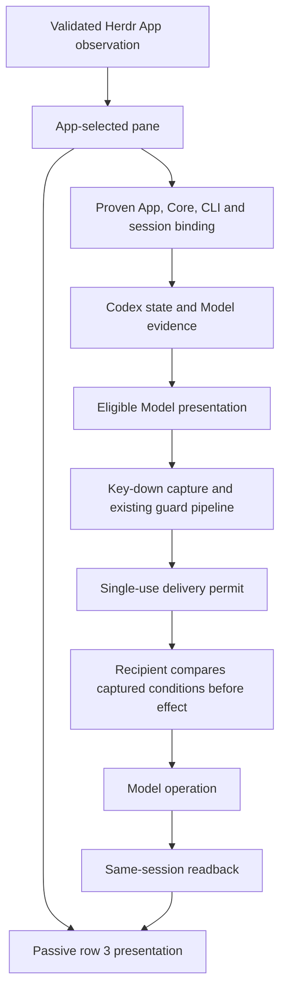

# Focused-pane agent controls for Herdr App

**Author** DeckShep Goldfish review  
**Date** 2026-11-14  
**Status** Historical section-approved draft, finalized 2026-11-14. The linked final design contains the post-review revision.  
**Final design** [Herdr App agent controls](../HERDR-APP-AGENT-CONTROLS-DESIGN.md)

## Overview

When a user clicks a Codex or Claude Code pane in Herdr App, the bottom row of the Stream Deck should follow that pane automatically. For example, clicking from a ready Codex chat into a working Claude session should retire Codex’s Model key as soon as DeckShep observes the switch. A user who then moves to their editor should still be able to use the controls DeckShep can verify for that Claude session while the editor keeps keyboard focus. The long-term reference is the Rex layout for each provider and state. [Reviewed controls brief](concepts_brief.md) · [Rex profile and key map](../../PROFILES.md)

The first milestone is passive focus tracking. The first action to verify end to end is **Model** on a ready Codex CLI session, in row 3, column 1. These milestones have separate success criteria. Showing the right key demonstrates focus tracking. Reading back the intended model from the target session after one press demonstrates the setting change.

## The Problem

Herdr can report that pane A is selected while DeckShep shows **On deck** on pane B. This happens when the user browses locally or when Herdr has yet to report a requested switch. Row 3 currently defaults to empty. Using the last deck choice to populate it could put B’s Model button under the user’s finger while they are looking at A. An agent closing and leaving a shell in the same pane creates a similar risk. [Herdr App guide](../../HERDR-APP.md)

The reviewed App interface reports the selected pane. The Core CLI and API can separately identify a terminal and its foreground process. Two Core instances can each have a terminal named `t7`, and two chats can use the same folder. A second problem arises after identification. Core can hold a key before writing it, during which time a user can switch panes or start a new turn. The design needs evidence that ties the pane to the exact session and that a stale press expires before its first effect, including opening a picker. [Herdr App and Core source review](../../adr/0007-herdr-app-0.1.14-source-review.md)

## Goals

1. **Follow clicks and state changes.** On a virtual deck with a ready Codex pane and a working Claude pane, clicking either in Herdr should update row 3 on the next validated observation. A local deck selection or Page press must leave the target tied to Herdr’s selected pane. A transition from ready to working in the same Codex chat must retire the ready-state Model action. A shell, closed pane or ambiguous observation must clear eligibility. A generic “blocked” report alone cannot identify a particular question or approval.
2. **Keep background use predictable.** Switching to an editor should preserve controls for the last pane focused in the configured Herdr window while the pane, session and relevant state can still be verified. Herdr must stay in the background throughout the press. The editor must retain keyboard focus and receive zero keystrokes from DeckShep. Backgrounding the Mac app is independent of whether the agent is running a background task.
3. **Verify one Rex-equivalent Model press.** In an isolated setup with two Codex chats in the same folder, press Model on the ready target. Verify from that session that its model advances exactly once to the next model in the order Rex uses and that its reasoning effort is preserved. Check the other chat, draft text and saved defaults for unintended changes. Run the same positive case with Herdr frontmost and with an editor frontmost. A deck caption or request acknowledgement alone cannot establish the result. [Rex Codex Model behavior](../../../src/agents/codex/keyboard-settings.ts)
4. **Measure stale presses at the recipient.** Delay a captured press, change the focused pane, replace the chat, or start a turn before the first effect. Include a switch from A to B and back to A, a reconnect, and a different Core with the same terminal address. After pending input has drained, require zero picker opens, keystrokes or model changes from the stale press. If a reply is lost after dispatch, treat the outcome as uncertain and never replay the press. Model stays unavailable wherever these guarantees cannot be demonstrated. [Guarded delivery](../../adr/0002-guard-pipeline-and-single-deliver.md)

## Non-Goals

Later milestones cover active Claude controls and the remaining Codex settings, composer, interruption and approval actions. This first verification is scoped to local CLI sessions in the experimental Herdr App profile. Public packaging, Herdr TUI, remote terminals and automatic provider setup are outside its scope. The choice of how to deliver Model remains open for the technical plan.

## Technical Plan

### Focus observations and row 3

Extend the experimental App controller to hold a control target derived from the latest accepted App observation. Resolve `AppSelectionSnapshot.selected` against its local panes by all four address fields. The navigation controller’s `selected()` currently prefers the local deck choice. Row 3 must instead use the App-selected pane. A successful navigation request can move the control target only after a fresh App observation reports that pane. [Controller](../../../src/app/herdr-app-controller.ts) · [Selection types](../../../src/domain/app-selection.ts)

Use the existing single-flight status/list/status reader and refresh schedule for the passive stage. Publish one immutable observation to all five control keys. Each accepted change of pane or relevant reported state replaces the row 3 presentation and invalidates captures made against the previous presentation. Repeated identical observations preserve its arming time. Reader disposal, a replacement endpoint, a failed read or an ambiguous view retires the control target and its outstanding work. Source generations must distinguish a new reader even when its pane IDs match the old reader’s IDs. Completion from an earlier reader must never overwrite a newer target. [Reader](../../../src/terminals/herdr-app/selection.ts)

The passive stage can identify a ready Codex pane and show an informational Model face in row 3, column 1. It can also clear that position when the pane becomes working, closes or becomes a shell. App-reported state is too coarse to draw question and approval actions with reliable semantics. Use the Rex layout once provider evidence distinguishes those states. An informational face publishes action `none`, so a caption cannot grant input authority. The first active control in this design is Model. [Shared state layout](../../../src/domain/layout.ts)

A lost observation clears action eligibility immediately when the failure is known. Every active Model press additionally obtains fresh evidence within its original press deadline. Cached observations and matching before/after snapshots alone cannot prove continuous focus. A production mutation needs receiver evidence that records intervening changes, including A → B → A. The technical plan therefore distinguishes the existing passive reader from the stronger evidence required by the Model delivery contract below.

### Running with Herdr in the background

The configured App window remains the source of pane selection while another Mac application is frontmost. Backgrounding Herdr does not replace the control target or change the agent’s provider state. Reconnection requires a fresh observation and fresh arming. A source that cannot observe reliably in the background makes the affected action unavailable.

Both Model candidates below address the verified session through an application connection. Neither candidate uses global keystrokes or activates Herdr as a delivery step. The native experiment must record the frontmost application before, during and after the operation. An editor accepts unrelated user typing throughout the experiment. Its input record must contain zero DeckShep keys, and Herdr must stay in the background. A background test succeeds only if the intended CLI also reports the requested setting afterward.

### Connecting the App pane to the CLI session

Introduce a proposed control observation contract alongside App navigation observations. It must identify the App process lifetime and window, the exact Core instance and connection lifetime the App uses, the local terminal address and lifetime, the foreground CLI process identity, and the provider session identity. Process identity includes owner, executable, PID and start time. A same-PID process replacement or a different chat inside the same CLI invalidates the binding.

The required input comes from an authoritative App-to-Core connection observation. A configured Core socket or its `hello.core.id` identifies the Core DeckShep contacted. Matching that Core’s `t7` to the App’s `t7` still requires evidence from the App’s active connection. The reviewed App socket and shared layout document do not establish that connection. Richer mod snapshots would require their own freshness and connection-lifetime proof. This contract is a proposed dependency whose implementation and supporting interface must be demonstrated before active Model is enabled. [Source review](../../adr/0007-herdr-app-0.1.14-source-review.md)

Use the Core CLI and API for equivalent evidence inspection. The CLI can expose the live schema through `hc schema`; runtime code can use the existing typed socket client for `hello`, `server.status`, `terminal.get` and the necessary event subscription. Validate external responses at the schema boundary. Maintain a local connection epoch across disconnects and treat missed events as loss of continuity. Core’s protocol generation describes compatibility. A separate process and connection lifetime identifies the particular running Core. [Pinned Core protocol README](https://raw.githubusercontent.com/herdrdev/herdr-core/3965a46caae095a3ead01de237fa13955e52b8c6/schema/README.md) · [Core reader](../../../src/terminals/herdr-app/core-status.ts) · [Schemas](../../../src/schemas/herdr-app.ts)

After proving the App/Core relationship, obtain provider evidence from that terminal’s verified CLI process. Any chat lookup must be tied to that process and current root session. A title, working directory or sole matching daemon entry is insufficient on its own. The existing `AppCodexControls` prototype can inform the evaluation, but its candidate PID/title lookup requires stronger ownership evidence for this feature. [Prototype](../../../src/app/herdr-app-codex.ts)

### Model semantics and delivery choices

The expected result follows the current Rex implementation. Read the current model and effort, advance one entry in the CLI picker’s order with its wrap behavior, preserve effort, and apply to this session. An unsupported effort or an unrecognized menu stops the operation. Read back the setting from the same verified session. The existing daemon path filters a separately obtained model catalog for effort compatibility, so its choice can differ from the next CLI entry. An API path must demonstrate equivalent order and session-only behavior for the supported CLI contract. [Native Model cycle](../../../src/agents/codex/keyboard-settings.ts) · [Daemon model selection](../../../src/agents/codex/daemon.ts)

The owner approved evaluating both paths before selecting delivery. Rex-equivalent behavior and operation while Herdr stays in the background remain requirements. The first evaluation ran the existing native and daemon fixtures and direct in-memory probes. Its results are recorded below. [Delivery evaluation](delivery_evaluation.md)

| Option | Mechanism | Trade-off and failure condition |
| --- | --- | --- |
| Native picker through guarded terminal delivery | Reuse the Rex Codex picker logic through a Herdr backend with verified pane reads, cursor evidence and conditional key delivery. | Closely follows the CLI’s offered order. Requires reliable background screen/cursor reads and a receiver that rejects stale keys at execution. Text-only reads or unconditional queued keys cannot satisfy the contract. |
| Provider API with verified equivalence | Address the proven Codex session through a settings operation, after comparing its catalog and setting semantics with the native picker. | Avoids a multi-step keyboard interaction. Requires receiver enforcement of expected focus/session/state and equivalent ordering and effort behavior. The existing settings update lacks the complete cross-application condition. |
| Evaluate both before selecting delivery | Complete the same passive tracker and run contract tests for both candidates on disposable fixtures and, with separate authorization, isolated native instances. Record which prerequisites each satisfies before selecting one for activation. | Adds research work and postpones an active button. Both candidates may require upstream support. This option ends with evidence for the next architecture decision. |

The initial evaluation found that both current paths require further capability before activation. All 24 tests in the four inspected native/daemon/App fixture files passed. A direct probe using the real native cycle chose Beta from picker order Alpha, Beta, Gamma. The daemon selection helper chose Gamma from API order Alpha, Gamma, Beta. A second probe showed that a settings update can apply to A after the final client focus check on A has passed and simulated focus has moved to B. The client then reports success from A’s setting readback. These establish a catalog-equivalence gap and a missing focus-at-application condition. They provide no native background evidence. [Executed checks and results](delivery_evaluation.md)

For Model eligibility, preserve Rex’s empty-composer or recognized-current-picker prerequisites as part of evaluating either route. The existing API operation can preserve a nonempty draft while changing the model, whereas Rex refuses that action from the composer. Apply the same eligibility rule to achieve Rex equivalence. Native Core reads currently lack the cursor evidence needed for the composer check. A provider route would also need an authoritative way to establish the relevant CLI eligibility.

The next comparison is conditional on a supported source for the App’s active Core connection and recipient enforcement of the captured conditions. Native picker delivery additionally needs a suitable screen/cursor observation. API delivery additionally needs proven catalog ordering and equivalent draft, effort and session-only behavior. Select a route when its full acceptance cases pass. If neither qualifies, the design carries these dependencies forward while the passive tracking milestone remains independently deliverable.

### What must hold when Model takes effect

Capture the target, action, presentation revision and press time at key-down. Bind them to the source lifetime, provider session, ready-state revision, current model/effort and relevant view or menu digest. A current receiver-issued focus revision must advance on every relevant focus change, including a switch away and back. The observation must carry the revision used by the receiver, so the comparison has a defined meaning. App, Core and provider coordination remains part of proving that receiver contract.

Preserve the existing 350 ms arming interval and two-second queue limit. Expiry applies at the recipient before an effect, even if transport work was accepted earlier. Hiding a key, revoking consent or changing source/session/state invalidates the capture. A second tap during pending work cannot issue a duplicate operation.

Route terminal and provider mutations through the existing `DeliveryKernel`, guard pipeline and single-use permits. Compose provider and terminal evidence in `src/app` so each existing layer keeps its responsibilities. Extend the App controller to create a provider control context only after the ownership chain is proven. Gate rendering, overrides and delivery on the same per-control verification record and action eligibility. Input consent must be explicit and checked again at final I/O. Its eventual setup wording and migration behavior belong in the detailed implementation plan. [Delivery kernel](../../../src/app/delivery.ts) · [Capability gates](../../../src/domain/capabilities.ts)

At the recipient, compare the captured conditions and start the first effect as one ordered operation. A wrapper that checks and then queues an unconditional key leaves a gap. The reviewed Core queue waits for human quiet before preparing input, and individual writes occur later. Its existing keys interface lacks the complete captured-context comparison. Reducing the quiet time or closing the client socket cannot establish expiry of accepted work. Supporting delivery must enforce the condition where the effect is committed. [Pinned Core input implementation](https://raw.githubusercontent.com/herdrdev/herdr-core/3965a46caae095a3ead01de237fa13955e52b8c6/crates/herdr-core/src/input.rs)

For a native cycle, record each expected transition caused by the operation, such as opening the model picker, separately from external changes. Each subsequent write needs a fresh conditional check against that expected stage. A change before the first effect produces zero effects. A change after a picker has opened stops remaining writes and can leave partial UI state. Report that outcome as incomplete or uncertain and require a fresh user action. The design does not promise rollback of a multi-step picker interaction. If all-or-nothing completion across the whole interaction becomes a requirement, it needs a further receiver capability and an explicit scope decision.

### Data flow and code boundaries

Proposed integration points are the App controller and view, App selection domain types, boundary schemas and Herdr readers, Codex provider logic, and the shared delivery/kernel and verification interfaces. Reuse `homeRow` and `key-face` formatting where provider evidence supports the corresponding Rex state. Keep the new tracking and eligibility projection in pure modules outside the controller closure. The detailed implementation plan will enumerate files after the delivery choice establishes which interfaces need extension.

### Evidence for enabling Model

First use synthetic receivers and virtual Stream Deck tests to verify passive clicks, state changes, closed panes, local deck selection disagreement, background observations, stale completions and rearming. A fixture that implements the proposed conditional operation proves client behavior against that contract. Native evidence must establish that the selected real delivery route provides it.

The isolated native setup needs two Core instances with colliding terminal addresses, two Codex chats in one folder, a background editor, and observations of actual recipient effects. Compare each positive Model transition with Rex on the same supported CLI/model catalog, including wrap and effort behavior. Verify the target chat, other chat, draft and saved defaults. Repeat with delayed delivery, A → B → A, process/chat replacement, a newly working turn, reconnect, consent revocation and a disconnect after acceptance. Let all queued work drain before counting effects. Observe the first effect and every later write for the native route. Record successful readback, pre-effect refusal, partial completion and uncertain outcomes separately.

Fixed diagnostic reasons can identify lost focus, an unbound Core or an unverified result. Keep prompts, terminal contents, private paths and session identifiers out of logs. These are proposed verification steps. Enabling a control requires evidence for its particular route and supported runtime contract.

## Alternatives Considered

### Native Codex picker through Herdr

Retain this path for evaluation. Reusing the Rex picker logic offers a direct way to match its model order, wrap behavior, effort preservation and session-only application. Its current tests exercise those behaviors against a synthetic screen. The Herdr adapter would need a passive screen and cursor observation, a proven App/Core/session binding, and conditional delivery at every write. The current text-only Core read and unconditional key request leave those requirements unresolved. [Native cycle](../../../src/agents/codex/keyboard-settings.ts) · [Delivery comparison](delivery_evaluation.md)

Background operation must be demonstrated with an editor retaining keyboard focus throughout the cycle. Opening a picker counts as the first effect. An intervening pane or state change before that effect must expire the press. Later changes must stop the remaining writes and report partial or uncertain completion. This route adds several observed UI transitions and is sensitive to CLI menu changes. Those costs remain part of the comparison.

### Codex provider API

Retain this path for evaluation. A settings operation addressed to a proven CLI chat could change the model while Herdr stays in the background, with fewer UI transitions. The existing daemon cycle reads back the requested model and unchanged effort. Its implementation provides useful evidence for a candidate operation. [Daemon cycle](../../../src/agents/codex/daemon.ts)

The evaluation reproduced a different next-model choice when API catalog order differed from picker order. The helper also skips entries that lack the current effort and selects the first compatible entry when the current model is absent. Its availability with a nonempty composer differs from Rex. The candidate must match Rex’s order, eligibility and session-only behavior before selection. A successful settings readback also needs a proven App/Core/session binding and conditional application. The simulated receiver applied a change to A after focus moved to B, despite the final client check passing on A. [Reproduced findings](delivery_evaluation.md)

### Select a delivery path before completing the comparison

Rejected by author. The approved direction is to evaluate both paths while retaining Rex-equivalent behavior and background operation. The initial source and fixture checks reveal distinct gaps in each. Choosing the native path on its picker behavior alone would leave delivery and observation unproved. Choosing the API path on its thread address alone would leave ordering, eligibility and focus-at-application unproved.

The selection criterion is the full set of acceptance cases in the technical plan. Record results for each route and select only a qualifying route. A failure or uncertain result during an operation must never trigger automatic delivery through the other route. Such a second attempt could repeat a change that already took effect.

### Drive row 3 from the last local deck selection

Rejected by author through the approved automatic focus-following goal. This would reuse the navigation controller’s local choice, but a click in Herdr can select a different pane. With focus consent off, choosing B on the deck while Herdr still reports A would put B’s controls under an A-focused workflow. The control target follows fresh App selection evidence. Page browsing and local navigation remain separate inputs to the display. [Reviewed alternatives](concepts_brief.md)

### Raise Herdr and use the frontmost application’s keyboard

Rejected by author through the approved background-operation requirement. Raising Herdr could simplify native keyboard access, but it would take keyboard focus from the editor. Activation would itself be an effect before the setting change. Each retained route must address the verified target through its application connection while the editor remains frontmost.

### Enable writes using repeated App and Core reads

Retain the existing reads for passive tracking and evidence gathering. Reject them as sufficient authority for active Model. Matching addresses, folders or names cannot distinguish two Core instances containing the same local terminal address. Equal snapshots can also miss A → B → A. A final client check followed by an unconditional queued request cannot enforce the approved stale-press outcome at application time. These are technical exclusions established by the reviewed contracts and evaluation. [Ownership and delivery findings](delivery_evaluation.md)

### Supported conditional operation at the recipient

Carry this forward as a capability dependency for both routes. An operation that compares captured focus, process/session, ready state and expiry where it takes effect could close the interval left by client checks. The native route needs the condition at terminal delivery. The provider route needs it at settings application. Coordination must make the App’s focus revision meaningful to the recipient, including reconnects and switches away and back.

The cost is additional protocol support and validation across App, Core and provider lifetimes. A helper or mod that publishes a cached snapshot alone leaves the same interval unresolved. This design defines the required behavior and acceptance evidence. Choosing an upstream extension or another supported implementation depends on the remaining interface investigation. [Brainstorm analysis](concepts_brief.md) · [Technical evaluation](delivery_evaluation.md)

## Detailed Implementation Plan

This is one ordered implementation list. It specifies passive tracking and an executable comparison of both Model candidates against test-owned receivers. Production activation depends on demonstrating an authoritative App/Core connection and conditional application in a real receiver. The evaluation has established gaps in the available interfaces. Step 8 must establish the exact supported wire contract, adapter implementation files and native evidence for a qualifying route before activation can be specified. The plan below makes that dependency an explicit outcome of the comparison.

1. **Define the control target and candidate contracts.**

   | File | Change and reason |
   | --- | --- |
   | `src/domain/app-control.ts` — create | Define immutable passive control observations, verified Model bindings, captured Model requests, receiver results and the two candidate port interfaces. Keep the contracts independent of platform, provider implementations and terminal implementations. |
   | [src/domain/types.ts](../../../src/domain/types.ts) — modify | Add optional App Model evidence to `PressContext` and support a genuinely bound App agent in the typed provider snapshot. This lets existing guards carry the captured evidence without casting navigation addresses into process identities. |
   | [src/domain/backend.ts](../../../src/domain/backend.ts) — modify | Carry the optional captured App control condition on input actions so it reaches the backend that consumes the permit. Describe the exact Model settings command through a restricted operation interface. |

   A passive observation contains the source lifetime, selected `AppPaneRef`, recognized provider, reported state and presentation revision. A verified binding additionally contains the App/window lifetime, Core identity and connection epoch, terminal lifetime, OS process owner/PID/start/executable identity, root provider session, recipient focus/state revisions, current model/effort and recognized composer or picker evidence. A Model request captures those conditions, the presentation and visibility revision, the original press time and expiry, and its single-use operation identity. These fields are in-memory authority and must never be logged as diagnostics. Define expiry in the recipient’s clock domain through a receiver-issued deadline or equivalent bounded ticket. A client timestamp alone cannot supply recipient expiry, and recovery cannot extend the original press budget.

   Candidate results distinguish a verified setting result, refusal before the first effect, known partial completion, and uncertainty after dispatch. Each candidate exposes passive observation, execution with the captured condition, and disposal. The native candidate also supplies the existing `KeyboardPort` operations. The API candidate supplies the ordered model catalog and the scoped settings operation. These are client contracts for evaluation. They do not assert that current upstream servers implement the proposed conditional operation.

2. **Implement the pure focus and eligibility projection.**

   | File | Change and reason |
   | --- | --- |
   | `src/domain/app-controls.ts` — create | Resolve the App-selected pane and derive its informational or eligible Model presentation. Return target changes and invalidation reasons as pure values. |
   | `tests/unit/herdr-app-controls.test.js` — create | Check projection, target identity and arming across identical observations, pane/state changes, shells, stale sources and local deck selection disagreement. |

   Resolve all four fields of the selected address against one accepted snapshot. A recognized local ready Codex pane can supply an informational Model face. A missing match, duplicate match, shell or unsupported provider clears Model eligibility. Preserve the existing provider mapping of idle/done/error into ready only when provider evidence supports it. A reported error can produce an informational face, while an actual busy or unresolved CLI refuses activation. Generic blocked state supplies no question or approval identity.

   Increment the control revision on a changed target, relevant state or evidence lifetime. Preserve it and the 350 ms arming deadline across identical observations. An observed source interruption permanently invalidates its captures. A local revision supports passive rendering. Active delivery additionally compares the recipient’s continuous focus/state revisions, including changes that the poll missed.

3. **Compose tracking into the App controller and render row 3.**

   | File | Change and reason |
   | --- | --- |
   | [src/app/herdr-app-controller.ts](../../../src/app/herdr-app-controller.ts) — modify | Keep the projected App control target beside navigation state, publish its presentation, invalidate pending Model work and handle Model presses through an injected candidate service. |
   | [src/app/herdr-app-view.ts](../../../src/app/herdr-app-view.ts) — modify | Recognize the row 3, column 1 Model face and its informational/actionable states. Extend the presentation type with optional control evidence. Keep captions in this pure view. |
   | [src/app/controller.ts](../../../src/app/controller.ts) — modify | Supply the optional control-service dependency, preserve key-down capture and existing serial scheduling, and retire candidate work on profile/source lifecycle changes. The production dependency is unavailable until qualification. |
   | [tests/integration/herdr-app-controller.test.js](../../../tests/integration/herdr-app-controller.test.js) — modify | Exercise clicks represented by accepted App observations, source replacement, unchanged polls, bank following, local choices, closure and stale asynchronous completion. |
   | [tests/unit/herdr-app-view.test.js](../../../tests/unit/herdr-app-view.test.js) — modify | Assert the Model caption, unavailable state, selected target presentation and existing key-size limits. |

   Retain the current 750 ms App refresh schedule and one-second bounded reader. Every accepted observation updates the projection once for the whole row. Measure refresh-to-render behavior with the fixture clock. Those intervals describe scheduling and read limits, and grant no continuity proof for delivery. Continue passive observations while candidate work is pending so observed changes can cancel it. Guard accepted completions by source identity and operation identity.

   Apply the existing Rex bank-following behavior when the App-selected pane actually changes. Reveal its occupied bank once, then allow subsequent local Page browsing. An identical poll must never pull the user back to that bank. This resolves off-bank presentation by reusing the Rex behavior already requested. Model’s setting subtitle remains the setting label. Its control target continues to follow the App when a different bank is browsed.

   Render an informational Model face for an App-reported ready Codex pane with action `none` until the candidate is eligible. When eligible, use the Rex Model position and formatting and the current verified value. Unknown values stay blank. A working/shell/closed target retires the ready Model action. Revocation and detachment must invalidate captures immediately, including during queued or awaiting work. Backgrounding the Mac app preserves the configured-window target while valid observations continue.

4. **Build the shared guarded Model orchestrator.**

   | File | Change and reason |
   | --- | --- |
   | `src/app/herdr-app-controls.ts` — create | Join the terminal-owned binding and provider-owned Model operation, manage one operation at a time, construct the real guard/delivery context and publish readback only for the original live source/session. |
   | [src/app/delivery.ts](../../../src/app/delivery.ts) — modify | Carry the captured App condition to the backend and add a restricted Model command entry point through the existing private `deliver()` method. Check App consent and verification at every I/O edge. |
   | [src/guards/pipeline.ts](../../../src/guards/pipeline.ts) — modify | Include the App evidence in permit consistency checks and reject old source/session/state captures. Each low-level mutation consumes its own permit. |
   | [src/guards/verified-control.ts](../../../src/guards/verified-control.ts) — modify | Permit the exact `/model` command only for a verified Model control at the captured empty-composer stage. Other paste text remains subject to its existing control restrictions. |
   | [tests/integration/delivery.test.js](../../../tests/integration/delivery.test.js) — modify | Prove permits cannot cross route, target, stage, source, control or verification-record boundaries. Check the restricted command and rejected arbitrary text. |

   Build `AgentSnapshot` and `PressContext` only from the verified ownership chain. The App address alone cannot supply a PID or chat ID. Keep App-selected control state distinct from the navigation controller’s local choice. Feed the service through composition in `src/app`; provider code and terminal code communicate through the neutral contracts.

   Use the original key-down context. A queued or pending repeat cannot create a second operation or recapture a newer target. Keep the two-second stale-press rule and the receiver expiry defined by the captured request. The native candidate obtains a new single-use permit for each expected stage while retaining that original operation and target. A permit for one key cannot authorize the next key. Capture the supported route in the operation and reject a route change during execution.

   Apply readback/input opt-ins and the per-control verification record in the evaluation service. The evaluation uses explicit test-owned consent. Existing saved input flags or overrides cannot make the production factory available. Specify production consent UI and migration in step 8 once the actual qualified operation is known. This avoids treating old inactive settings as authorization for newly available writes.

5. **Implement both candidate adapters for the comparison.**

   | File | Change and reason |
   | --- | --- |
   | `tests/helpers/herdr-app-model-receiver.ts` — create | Provide separate test-owned native and API receivers with effect logs, focus/session/state revisions, queues, virtual time, simulated Mac activation and conditional application. Also provide intentionally unconditional modes to reproduce the known gaps. |
   | [tests/helpers/keyboard-screen.ts](../../../tests/helpers/keyboard-screen.ts) — modify | Model per-model effort availability and distinct picker/catalog ordering so both candidates face the same settings cases. Preserve existing default fixture behavior. |
   | `tests/contract/herdr-app-model.test.js` — create | Run one shared contract matrix against both receivers using the actual guard pipeline. Count effects after delayed work drains. |
   | [tests/unit/rex-keyboard-settings.test.js](../../../tests/unit/rex-keyboard-settings.test.js) — modify | Cover the comparison’s reference cases, including incompatible next-model effort and catalog ordering. |
   | [tests/integration/daemon-controls.test.js](../../../tests/integration/daemon-controls.test.js) — modify | Make the existing API helper’s ordering/filtering behavior explicit so future changes cannot silently claim Rex equivalence. |

   The native test adapter calls the real `cycleCodexSetting` through `KeyboardPort`. Its reads include the exact fixture cursor and text digest. Before every command or key the receiver compares the captured target, session, focus revision, expiry and expected screen stage. Expected transitions caused by the operation advance its stage evidence. External changes invalidate it. A change before `/model` produces no effect. A change after it opens stops remaining writes and records any partial UI state.

   The API test adapter evaluates the same eligibility and next-entry policy against a proven ordering input, then sends a single model update and verifies unchanged effort. Preserve Rex’s refusal when the next picker entry cannot support current effort or the current entry is unrecognized. The existing daemon helper remains a baseline for the reproduced mismatch. The test adapter must not silently substitute a filtered catalog for the picker order. Where a real API cannot provide the required ordering or composer evidence, record that case as unsupported.

   Both conditional receivers compare and apply at the effect boundary and log any picker opens, highlights, writes and setting changes. Limit native requests to the exact expected command or picker key for the current stage. Limit API mutations to the captured thread/model update. Exercise rejected arbitrary keys, command text and unrelated settings as contract failures. The intentionally unconditional receiver must demonstrate that client checks alone cannot stop delayed effects. A simulated result verifies the proposed contract and client behavior. It grants no capability to a real backend.

6. **Exercise both candidates through the virtual Stream Deck.**

   | File | Change and reason |
   | --- | --- |
   | [tests/e2e/virtual-host/scenarios.ts](../../../tests/e2e/virtual-host/scenarios.ts) — modify | Define App-selected panes, passive reported state, bound CLI state and candidate route as distinct scenario facts. Include same-folder Codex sessions and another recognized provider. |
   | [tests/e2e/virtual-host/scenario-dependencies.ts](../../../tests/e2e/virtual-host/scenario-dependencies.ts) — modify | Inject the two test adapters through the same app composition and delivery kernel used by normal presses. |
   | [tests/e2e/virtual-host/deck.ts](../../../tests/e2e/virtual-host/deck.ts) — modify | Expose bounded test commands for focus changes, delayed delivery, expiry, receiver release and simulated activation. Include structured effect counts in snapshots. |
   | [tests/e2e/herdr-app.spec.ts](../../../tests/e2e/herdr-app.spec.ts) — modify | Add passive focus cases and parameterized Model journeys for each route, including background operation, races, duplicate presses and uncertain results. |
   | [tests/helpers/plugin-harness.js](../../../tests/helpers/plugin-harness.js) — modify | Pass the optional fixture control service for integration tests while keeping its production default unavailable. |
   | [tests/integration/herdr-app-daemon-controls.test.js](../../../tests/integration/herdr-app-daemon-controls.test.js) — modify | Retain old override/inactive-consent checks and add a positive Model case only with explicit injected binding, consent and a verified Model record. |

   Use ordinary `willAppear`, settings, key-down and key-up entry points. Manually selecting a different fixture App pane must change row 3 without a deck tap. Local deck selection must leave the control target on the App pane. Parameterize the same positive Model/readback case over native and API candidates. Simulated activation must stay on the editor and its received-key count must remain zero. Label this evidence as browser/fixture evidence.

7. **Prove invalidation with one common acceptance matrix.**

   Put these cases in the unit, contract, integration and browser files named above, at the lowest level that can observe each failure. Avoid multiplying identical scenarios across every test layer. Test the full key press through the browser for the focus switch, background positive, expired delivery and uncertain-result cases.

   | Trigger between capture and effect | Expected result at the recipient |
   | --- | --- |
   | Focus A → B or A → B → A | Old capture refuses with zero effects, even if the final snapshot equals A. |
   | Wrong Core with the same address, reconnect, replacement App source, lost event continuity | Old binding and pending operation expire. Recovery requires fresh evidence and arming. |
   | PID reused with a new start time, root chat replaced in the same CLI, ready chat starts work | No old Model mutation. |
   | Draft edited, cursor moved, menu/highlight/catalog changed | No next stale write. Count any prior effects as partial completion. |
   | Consent revoked, key hidden/remapped, scope switched, queue limit or recipient expiry exceeded | No late first effect, including after releasing a held receiver queue. |
   | Identical polls, local Page browsing, unrelated Mac app becomes active | Valid target continuity persists. Model changes once only when all action-specific conditions hold. |
   | Reply lost after application | Report uncertainty, issue zero retries and zero automatic fallback calls. |

   Positive cases must cover normal advance, wrap, hidden footer with recognized picker evidence, unsupported next-entry effort, unknown current model, and nonempty or multiline draft. Compare intended chat, other chat, effort, draft and defaults. A readback of the requested value alone cannot pass a focus-continuity case. Preserve current provider-specific refusal behavior.

8. **Investigate the real receiver contracts and prepare native validation.**

   | File | Change and reason |
   | --- | --- |
   | [delivery_evaluation.md](delivery_evaluation.md) — update | Record exact upstream source revisions, supported methods/parameters and separate outcomes for the two candidates. Distinguish inspected source, fixture results and native results. |
   | `docs/plans/herdr-app-agent-controls/native-model-validation.md` — create | Specify the test-owned launcher, actual Codex session creation and identity proofs, editor activation/input observation, effect instrumentation, cleanup and command allowlists for later native validation. |

   Identify the authoritative App/Core connection observation and its change sequence. Check the actual recipient for conditional compare-and-apply and expiry. For native delivery also identify a supported passive text/cursor observation and every expected picker transition. For API delivery prove catalog order, draft eligibility and settings semantics against the supported CLI. An upstream capability that is absent is a concrete dependency. Do not implement a local snapshot wrapper and classify it as recipient enforcement.

   The existing navigation launcher’s simulated Codex/Claude panes cannot verify a model setting. The native runbook must describe actual test-owned Codex chats, two isolated Cores with colliding addresses, and a background editor. It must provide ownership and containment proof before launching or delivering to any process. List required artifacts and exact versions, then count effects independently of the adapter’s claimed result. Cleanup is restricted to owned processes, endpoints and files.

   Execute native work only with the current live authorization required by repository instructions and reviewed artifacts for this expanded test. Historical navigation authorization and calibration do not establish a Model-capable launcher. If the ownership or conditional-application contract is missing, finish passive tracking and fixture comparison and record active Model as unqualified. When a supported real receiver contract is established, extend this step with the exact live adapter and runner file changes it needs before implementing them. The current interfaces cannot supply those changes concretely.

9. **Update product documentation and select delivery from evidence.**

   | File | Change and reason |
   | --- | --- |
   | [docs/HERDR-APP.md](../../HERDR-APP.md) — modify | Explain automatic row 3 focus following, informational Model and the evidence-dependent experimental control. State what happens when a pane closes or evidence expires. |
   | [docs/PROFILES.md](../../PROFILES.md) — modify | Document the App Model position and the distinction between reported readiness and an eligible action. |
   | [tests/e2e/README.md](../../../tests/e2e/README.md) — modify | Document the two virtual candidate suites and link the distinct native runbook. |
   | [AGENTS.md](../../../AGENTS.md) — modify | Update the App row 3 convention and verification commands when implemented, including the concrete production eligibility outcome. |
   | [design_draft.md](design_draft.md) — update | Reconcile implementation results with approved goals and record the selected route, continuing dependencies or an unqualified result. |

   Keep both candidates in the evaluation. Select one for activation only after it passes the same acceptance cases with real recipient evidence. If both qualify, present their measured trade-offs for the owner’s route choice. If neither qualifies, report the specific missing capabilities and retain the independently verified passive milestone. Complete step 8 with production consent, supported protocol negotiation and receiver adapter files before implementing that stage. A comparison outcome cannot relax Rex equivalence or background operation.

10. **Run verification and inspect the delivered changes.**

    Run focused tests while implementing each step, then the standard checks below once the changes are integrated. Preserve coverage thresholds and inspect any failures before extending capability. The commands are planned verification, and have not been run for this draft.

    | Check | Purpose |
    | --- | --- |
    | `npm run typecheck`, `npm run lint`, `npm run format:check`, `npm run deps`, `npm run knip` | Verify typed contracts, layering, readability and reachable code. Create candidate helpers alongside their actual callers and tests. |
    | `npm test`, `npm run test:golden`, `npm run test:coverage` | Verify the new state and delivery cases plus existing routing, input guards, fixture bytes and coverage thresholds. |
    | `npm run test:e2e -- tests/e2e/herdr-app.spec.ts --workers=1` | Exercise ordinary virtual deck events for both candidates. |
    | `npm run version:check`, `npm run compatibility:check`, `npm run build`, `npm run test:bundled` | Verify integration in the normal bundle without installing it. |
    | `npm run compat:codex` | Check that the installed CLI still offers methods used by the API candidate, using the repository’s compatibility check. Qualification also needs the exact native test runtime contract. |

    The planned file changes are enumerated in steps 1–9. New filenames shown in code text are proposed files to create. Linked files already exist. Golden JSON and existing screenshot baselines are expected to remain byte-stable because their scenarios cover the existing released layouts. The new Herdr cases inspect the intended new faces through dedicated assertions. Any discovered baseline impact must be justified and added explicitly to the plan before regeneration.

    Finish by checking target following, background operation, one Model change with same-session readback and every negative-case effect count. Report fixture and native evidence separately. The package continues to qualify Herdr features only through the experimental path and existing per-control checks. An implementation result must name any remaining Model dependency before it can be called complete.

## Open Questions

Evaluation of both Model paths is approved and its initial source/fixture results are recorded. Final delivery selection depends on authoritative App/Core connection evidence, conditional recipient behavior and native acceptance of the candidate route. The implementation plan carries forward those dependencies and uses Rex’s bank-following behavior for target visibility. Poll-to-render measurements and native qualification remain implementation evidence to collect. Step 8 must resolve the real adapter and consent migration once a receiver contract can be specified.
