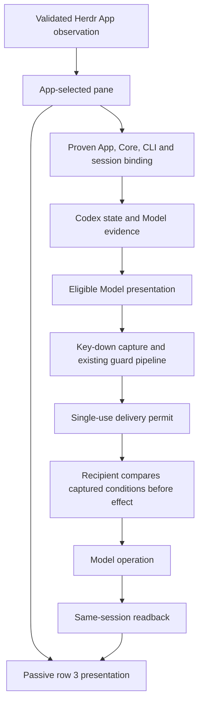

# Focused-pane agent controls for Herdr App

**Author** DeckShep Goldfish review  
**Date** 2026-11-14  
**Status** Revised to address all 11 consolidated Goldfish findings  
**Finalized** 2026-11-14  
**Revision** 2026-11-14, following the owner’s instruction to apply the review findings

## Overview

When a user clicks a Codex or Claude Code pane in Herdr App, the bottom row of the Stream Deck should follow that pane automatically. For example, clicking from a ready Codex chat into a working Claude session should retire Codex’s Model key as soon as DeckShep observes the switch. A user who then moves to their editor should still be able to use the controls DeckShep can verify for that Claude session while the editor keeps keyboard focus. The long-term reference is the Rex layout for each provider and state. [Reviewed controls brief](herdr-app-agent-controls/concepts_brief.md) · [Rex profile and key map](../PROFILES.md)

The first milestone is passive focus tracking. The first action to verify end to end is **Model** on a ready Codex CLI session, in row 3, column 1. These milestones have separate success criteria. Showing the right key demonstrates focus tracking. Reading back the intended model from the target session after one press demonstrates the setting change.

## The Problem

Herdr can report that pane A is selected while DeckShep shows **On deck** on pane B. This happens when the user browses locally or when Herdr has yet to report a requested switch. Row 3 currently defaults to empty. Using the last deck choice to populate it could put B’s Model button under the user’s finger while they are looking at A. An agent closing and leaving a shell in the same pane creates a similar risk. [Herdr App guide](../HERDR-APP.md)

The reviewed App interface reports the selected pane. The Core CLI and API can separately identify a terminal and its foreground process. Two Core instances can each have a terminal named `t7`, and two chats can use the same folder. A second problem arises after identification. Core can hold a key before writing it, during which time a user can switch panes or start a new turn. The design needs evidence that ties the pane to the exact session and that a stale press expires before its first effect, including opening a picker. [Herdr App and Core source review](../adr/0007-herdr-app-0.1.14-source-review.md)

## Goals

1. **Follow clicks and state changes.** On a virtual deck with a ready Codex pane and a working Claude pane, clicking either in Herdr should update row 3 on the next validated observation. A local deck selection or Page press must leave the target tied to Herdr’s selected pane. A transition from ready to working in the same Codex chat must retire the ready-state Model action. A shell, closed pane or ambiguous observation must clear eligibility. A generic “blocked” report alone cannot identify a particular question or approval.
2. **Keep background use predictable.** Switching to an editor should preserve controls for the last pane focused in the configured Herdr window while the pane, session and relevant state can still be verified. Herdr must stay in the background throughout the press. The editor must retain keyboard focus and receive zero keystrokes from DeckShep. Backgrounding the Mac app is independent of whether the agent is running a background task.
3. **Verify one Rex-equivalent Model press.** In an isolated setup with two Codex chats in the same folder, press Model on the ready target. Verify from that session that its model advances exactly once to the next model in the order Rex uses and that its reasoning effort is preserved. Check the other chat, draft text and saved defaults for unintended changes. Run the same positive case with Herdr frontmost and with an editor frontmost. A deck caption or request acknowledgement alone cannot establish the result. [Rex Codex Model behavior](../../src/agents/codex/keyboard-settings.ts)
4. **Measure stale presses at the recipient.** Delay a captured press, change the focused pane, replace the chat, or start a turn before the first effect. Include a switch from A to B and back to A, a reconnect, and a different Core with the same terminal address. After pending input has drained, require zero picker opens, keystrokes or model changes from the stale press. If a reply is lost after dispatch, treat the outcome as uncertain and never replay the press. Model stays unavailable wherever these guarantees cannot be demonstrated. [Guarded delivery](../adr/0002-guard-pipeline-and-single-deliver.md)

## Non-Goals

Later milestones cover active Claude controls and the remaining Codex settings, composer, interruption and approval actions. This first verification is scoped to local CLI sessions in the experimental Herdr App profile. Public packaging, Herdr TUI, remote terminals and automatic provider setup are outside its scope. Both delivery paths proceed through the approved evaluation before selection.

## Technical Plan

### Focus observations and row 3

Extend the experimental App controller to hold a control target derived from the latest accepted App observation. Resolve `AppSelectionSnapshot.selected` against its local panes by all four address fields. The navigation controller’s `selected()` currently prefers the local deck choice. Row 3 must instead use the App-selected pane. A successful navigation request can move the control target only after a fresh App observation reports that pane. [Controller](../../src/app/herdr-app-controller.ts) · [Selection types](../../src/domain/app-selection.ts)

When an App observation first reports a different selected agent, reveal that agent’s bank once, matching Rex’s focus-following behavior. The user can then browse other banks with Page while row 3 continues to target the App-selected agent. Repeated observations of the same selection preserve the browsed bank.

Use the existing single-flight status/list/status reader and refresh schedule for the passive stage. Publish one immutable observation to all five control keys. Each accepted change of pane or relevant reported state replaces the row 3 presentation and invalidates captures made against the previous presentation. Repeated identical observations preserve its arming time. Reader disposal, a replacement endpoint, a failed read or an ambiguous view retires the control target and its outstanding work. Source generations must distinguish a new reader even when its pane IDs match the old reader’s IDs. Completion from an earlier reader must never overwrite a newer target. [Reader](../../src/terminals/herdr-app/selection.ts)

The passive stage can identify a ready Codex pane and show an informational Model face in row 3, column 1. It can also clear that position when the pane becomes working, closes or becomes a shell. App-reported state is too coarse to draw question and approval actions with reliable semantics. Use the Rex layout once provider evidence distinguishes those states. An informational face publishes action `none`, so a caption cannot grant input authority. The first active control in this design is Model. [Shared state layout](../../src/domain/layout.ts)

A lost observation clears action eligibility immediately when the failure is known. Every active Model press additionally obtains fresh evidence within its original press deadline. Cached observations and matching before/after snapshots alone cannot prove continuous focus. A production mutation needs receiver evidence that records intervening changes, including A → B → A. The technical plan therefore distinguishes the existing passive reader from the stronger evidence required by the Model delivery contract below.

### Running with Herdr in the background

The configured App window remains the source of pane selection while another Mac application is frontmost. Backgrounding Herdr does not replace the control target or change the agent’s provider state. Reconnection requires a fresh observation and fresh arming. A source that cannot observe reliably in the background makes the affected action unavailable.

Both Model candidates below address the verified session through an application connection. Neither candidate uses global keystrokes or activates Herdr as a delivery step. The native experiment must record the frontmost application before, during and after the operation. An editor accepts unrelated user typing throughout the experiment. Its input record must contain zero DeckShep keys, and Herdr must stay in the background. A background test succeeds only if the intended CLI also reports the requested setting afterward.

### Connecting the App pane to the CLI session

Introduce a proposed control observation contract alongside App navigation observations. It must identify the App process lifetime and window, the exact Core instance and connection lifetime the App uses, the local terminal address and lifetime, the foreground CLI process identity, and the provider session identity. Process identity includes owner, executable, PID and start time. A same-PID process replacement or a different chat inside the same CLI invalidates the binding.

The required input comes from an authoritative App-to-Core connection observation. A configured Core socket or its `hello.core.id` identifies the Core DeckShep contacted. Matching that Core’s `t7` to the App’s `t7` still requires evidence from the App’s active connection. The reviewed App socket and shared layout document do not establish that connection. Richer mod snapshots would require their own freshness and connection-lifetime proof. This contract is a proposed dependency whose implementation and supporting interface must be demonstrated before active Model is enabled. [Source review](../adr/0007-herdr-app-0.1.14-source-review.md)

Use the Core CLI and API for equivalent evidence inspection. The CLI can expose the live schema through `hc schema`; runtime code can use the existing typed socket client for `hello`, `server.status`, `terminal.get` and the necessary event subscription. Validate external responses at the schema boundary. Maintain a local connection epoch across disconnects and treat missed events as loss of continuity. Core’s protocol generation describes compatibility. A separate process and connection lifetime identifies the particular running Core. [Pinned Core protocol README](https://raw.githubusercontent.com/herdrdev/herdr-core/3965a46caae095a3ead01de237fa13955e52b8c6/schema/README.md) · [Core reader](../../src/terminals/herdr-app/core-status.ts) · [Schemas](../../src/schemas/herdr-app.ts)

After proving the App/Core relationship, obtain provider evidence from that terminal’s verified CLI process. Any chat lookup must be tied to that process and current root session. A title, working directory or sole matching daemon entry is insufficient on its own. The existing `AppCodexControls` prototype can inform the evaluation, but its candidate PID/title lookup requires stronger ownership evidence for this feature. [Prototype](../../src/app/herdr-app-codex.ts)

### Model semantics and delivery choices

The expected result follows the current Rex implementation. Read the current model and effort, advance one entry in the CLI picker’s order with its wrap behavior, preserve effort, and apply to this session. An unsupported effort or an unrecognized menu stops the operation. Read back the setting from the same verified session. The existing daemon path filters a separately obtained model catalog for effort compatibility, so its choice can differ from the next CLI entry. An API path must demonstrate equivalent order and session-only behavior for the supported CLI contract. [Native Model cycle](../../src/agents/codex/keyboard-settings.ts) · [Daemon model selection](../../src/agents/codex/daemon.ts)

The owner approved evaluating both paths before selecting delivery. Rex-equivalent behavior and operation while Herdr stays in the background remain requirements. The first evaluation ran the existing native and daemon fixtures and direct in-memory probes. Its results are recorded below. [Delivery evaluation](herdr-app-agent-controls/delivery_evaluation.md)

| Option | Mechanism | Trade-off and failure condition |
| --- | --- | --- |
| Native picker through guarded terminal delivery | Reuse the Rex Codex picker logic through a Herdr backend with verified pane reads, cursor evidence and conditional key delivery. | Closely follows the CLI’s offered order. Requires reliable background screen/cursor reads and a receiver that rejects stale keys at execution. Text-only reads or unconditional queued keys cannot satisfy the contract. |
| Provider API with verified equivalence | Address the proven Codex session through a settings operation, after comparing its catalog and setting semantics with the native picker. | Avoids a multi-step keyboard interaction. Requires receiver enforcement of expected focus/session/state and equivalent ordering and effort behavior. The existing settings update lacks the complete cross-application condition. |
| Evaluate both before selecting delivery | Complete the same passive tracker and run contract tests for both candidates on disposable fixtures and, with separate authorization, isolated native instances. Record which prerequisites each satisfies before selecting one for activation. | Adds research work and postpones an active button. Both candidates may require upstream support. This option ends with evidence for the next architecture decision. |

The initial evaluation found that both current paths require further capability before activation. All 24 tests in the four inspected native/daemon/App fixture files passed. A direct probe using the real native cycle chose Beta from picker order Alpha, Beta, Gamma. The daemon selection helper chose Gamma from API order Alpha, Gamma, Beta. A second probe showed that a settings update can apply to A after the final client focus check on A has passed and simulated focus has moved to B. The client then reports success from A’s setting readback. These establish a catalog-equivalence gap and a missing focus-at-application condition. They provide no native background evidence. [Executed checks and results](herdr-app-agent-controls/delivery_evaluation.md)

For Model eligibility, preserve Rex’s empty-composer or recognized-current-picker prerequisites as part of evaluating either route. The existing API operation can preserve a nonempty draft while changing the model, whereas Rex refuses that action from the composer. Apply the same eligibility rule to achieve Rex equivalence. Native Core reads currently lack the cursor evidence needed for the composer check. A provider route would also need an authoritative way to establish the relevant CLI eligibility.

The next comparison is conditional on a supported source for the App’s active Core connection and recipient enforcement of the captured conditions. Native picker delivery additionally needs a suitable screen/cursor observation. API delivery additionally needs proven catalog ordering and equivalent draft, effort and session-only behavior. Select a route when its full acceptance cases pass. If neither qualifies, the design carries these dependencies forward while the passive tracking milestone remains independently deliverable.

### What must hold when Model takes effect

Capture the target, action, presentation revision and press time at key-down. Bind them to the source lifetime, provider session, ready-state revision, current model/effort and relevant view or menu digest. A current receiver-issued focus revision must advance on every relevant focus change, including a switch away and back. The observation must carry the revision used by the receiver, so the comparison has a defined meaning. App, Core and provider coordination remains part of proving that receiver contract.

Preserve the existing 350 ms arming interval and two-second queue limit. Expiry applies at the recipient before each effect, even if transport work was accepted earlier. Hiding/remapping a key, changing scope, revoking consent or changing source/session/state retires the capture. A second tap during pending work cannot issue a duplicate operation. The committing authority must observe DeckShep authorization changes as well as App focus and provider state.

Route terminal and provider mutations through the existing `DeliveryKernel`, guard pipeline and single-use permits. Compose provider and terminal evidence in `src/app` so each existing layer keeps its responsibilities. Extend the App controller to create a provider control context only after the ownership chain is proven. Gate rendering, overrides and delivery on the same route-specific verification record and action eligibility. Input consent must be explicit and checked again at final I/O. An API-only backend verifies provider settings capability, and receives no keyboard capability from its Model record. [Delivery kernel](../../src/app/delivery.ts) · [Capability gates](../../src/domain/capabilities.ts)

At the recipient, compare the captured conditions and start the first effect as one ordered operation. A wrapper that checks and then queues an unconditional key leaves a gap. The reviewed Core queue waits for human quiet before preparing input, and individual writes occur later. Its existing keys interface lacks the complete captured-context comparison. Reducing the quiet time or closing the client socket cannot establish expiry of accepted work. Supporting delivery must enforce the condition where the effect is committed. [Pinned Core input implementation](https://raw.githubusercontent.com/herdrdev/herdr-core/3965a46caae095a3ead01de237fa13955e52b8c6/crates/herdr-core/src/input.rs)

For a native cycle, record each expected transition caused by the operation, such as opening the model picker, separately from external changes. Each subsequent write needs a fresh conditional check against that expected stage. A change before the first effect produces zero effects. A change after a picker has opened stops remaining writes and can leave partial UI state. Report that outcome as incomplete or uncertain and require a fresh user action. The design does not promise rollback of a multi-step picker interaction. If all-or-nothing completion across the whole interaction becomes a requirement, it needs a further receiver capability and an explicit scope decision.

Local invalidation immediately disables new presses and reaches the committing authority independently of the serialized key-press queue. Revocation is complete when that authority closes the operation and acknowledges that no further effects can occur. A prior committed effect is reported as partial completion or uncertainty. Until acknowledgement, the UI must not claim that queued work was cancelled. The fixture contract below orders invalidation and effect commit on the same authority. A real receiver must demonstrate equivalent ordering. In particular, local invalidation ordered before a delayed first effect must stop that effect. A cancellation message that can lose that race does not satisfy the approved zero-late-effect case. This is an explicit receiver qualification dependency for both routes.

### Data flow and code boundaries



The implementation plan enumerates passive tracking first, source/interface feasibility and test-owned probes second, and active client integration only after a receiver satisfies the required contract. Reuse `homeRow` and `key-face` formatting where provider evidence supports the corresponding Rex state. Keep tracking and eligibility projection in pure modules outside the controller closure. Real adapter wire mapping, supported runtime records and activation settings remain dependent on the named feasibility evidence. The executable evaluation contracts and gated file lists below specify the client behavior.

### Evidence for enabling Model

First use synthetic receivers and virtual Stream Deck tests to verify passive clicks, state changes, closed panes, local deck selection disagreement, background observations, stale completions and rearming. A fixture that implements the proposed conditional operation proves client behavior against that contract. Native evidence must establish that the selected real delivery route provides it.

The isolated native setup needs two Core instances with colliding terminal addresses, two Codex chats in one folder, a background editor, and observations of actual recipient effects. Compare each positive Model transition with Rex on the same supported CLI/model catalog, including wrap and effort behavior. Verify the target chat, other chat, draft and saved defaults. Repeat with delayed delivery, A → B → A, process/chat replacement, a newly working turn, reconnect, consent revocation and a disconnect after acceptance. Let all queued work drain before counting effects. Observe the first effect and every later write for the native route. Record successful readback, pre-effect refusal, partial completion and uncertain outcomes separately.

Fixed diagnostic reasons can identify lost focus, an unbound Core or an unverified result. Keep prompts, terminal contents, private paths and session identifiers out of logs. These are proposed verification steps. Enabling a control requires evidence for its particular route and supported runtime contract.

## Alternatives Considered

### Native Codex picker through Herdr

Retain this path for evaluation. Reusing the Rex picker logic offers a direct way to match its model order, wrap behavior, effort preservation and session-only application. Its current tests exercise those behaviors against a synthetic screen. The Herdr adapter would need a passive screen and cursor observation, a proven App/Core/session binding, and conditional delivery at every write. The current text-only Core read and unconditional key request leave those requirements unresolved. [Native cycle](../../src/agents/codex/keyboard-settings.ts) · [Delivery comparison](herdr-app-agent-controls/delivery_evaluation.md)

Background operation must be demonstrated with an editor retaining keyboard focus throughout the cycle. Opening a picker counts as the first effect. An intervening pane or state change before that effect must expire the press. Later changes must stop the remaining writes and report partial or uncertain completion. This route adds several observed UI transitions and is sensitive to CLI menu changes. Those costs remain part of the comparison.

### Codex provider API

Retain this path for evaluation. A settings operation addressed to a proven CLI chat could change the model while Herdr stays in the background, with fewer UI transitions. The existing daemon cycle reads back the requested model and unchanged effort. Its implementation provides useful evidence for a candidate operation. [Daemon cycle](../../src/agents/codex/daemon.ts)

The evaluation reproduced a different next-model choice when API catalog order differed from picker order. The helper also skips entries that lack the current effort and selects the first compatible entry when the current model is absent. Its availability with a nonempty composer differs from Rex. The candidate must match Rex’s order, eligibility and session-only behavior before selection. A successful settings readback also needs a proven App/Core/session binding and conditional application. The simulated receiver applied a change to A after focus moved to B, despite the final client check passing on A. [Reproduced findings](herdr-app-agent-controls/delivery_evaluation.md)

### Select a delivery path before completing the comparison

Rejected by author. The approved direction is to evaluate both paths while retaining Rex-equivalent behavior and background operation. The initial source and fixture checks reveal distinct gaps in each. Choosing the native path on its picker behavior alone would leave delivery and observation unproved. Choosing the API path on its thread address alone would leave ordering, eligibility and focus-at-application unproved.

The selection criterion is the full set of acceptance cases in the technical plan. Record results for each route and select only a qualifying route. A failure or uncertain result during an operation must never trigger automatic delivery through the other route. Such a second attempt could repeat a change that already took effect.

### Drive row 3 from the last local deck selection

Rejected by author through the approved automatic focus-following goal. This would reuse the navigation controller’s local choice, but a click in Herdr can select a different pane. With focus consent off, choosing B on the deck while Herdr still reports A would put B’s controls under an A-focused workflow. The control target follows fresh App selection evidence. Page browsing and local navigation remain separate inputs to the display. [Reviewed alternatives](herdr-app-agent-controls/concepts_brief.md)

### Raise Herdr and use the frontmost application’s keyboard

Rejected by author through the approved background-operation requirement. Raising Herdr could simplify native keyboard access, but it would take keyboard focus from the editor. Activation would itself be an effect before the setting change. Each retained route must address the verified target through its application connection while the editor remains frontmost.

### Enable writes using repeated App and Core reads

Retain the existing reads for passive tracking and evidence gathering. Reject them as sufficient authority for active Model. Matching addresses, folders or names cannot distinguish two Core instances containing the same local terminal address. Equal snapshots can also miss A → B → A. A final client check followed by an unconditional queued request cannot enforce the approved stale-press outcome at application time. These are technical exclusions established by the reviewed contracts and evaluation. [Ownership and delivery findings](herdr-app-agent-controls/delivery_evaluation.md)

### Supported conditional operation at the recipient

Carry this forward as a capability dependency for both routes. An operation that compares captured focus, process/session, ready state, DeckShep authorization and expiry where it takes effect could close the interval left by client checks. The native route needs the condition at terminal delivery. The provider route needs it at settings application. Coordination must make App focus and DeckShep authorization revisions meaningful to the recipient, including reconnects, switches away and back, and consent or visibility changes.

The cost is additional protocol support and validation across App, Core and provider lifetimes. A helper or mod that publishes a cached snapshot alone leaves the same interval unresolved. This design defines the required behavior and acceptance evidence. Choosing an upstream extension or another supported implementation depends on the remaining interface investigation. [Brainstorm analysis](herdr-app-agent-controls/concepts_brief.md) · [Technical evaluation](herdr-app-agent-controls/delivery_evaluation.md)

## Detailed Implementation Plan

### Work order and feasibility boundary

The ordered file list below has four checkpoints. P1 delivers passive tracking. P2 investigates both real interfaces and runs small test-owned probes with existing provider code. Those checkpoints do not extend shared active-control authority. P3 introduces the kernel integration and candidate comparison only after the P2 record identifies a supported contract for the route being integrated. P4 qualifies native background behavior and determines production eligibility. Each checkpoint must leave a buildable, testable repository.

If a real contract cannot supply the required binding, conditional effects, authorization ordering or observation evidence, record the missing capability and finish P1/P2. Keep both candidates in the evaluation record. Test-only probes can explore missing semantics without adding speculative authority fields to production modules. The P3 client contract is specified here so a supported mapping has a concrete target. An incompatible upstream contract requires a documented revision before promotion into production types. Existing interfaces remain unqualified for active Model under the current evidence.

### P3 client and fixture contracts

These are proposed TypeScript declarations, not implementation code or claims about an existing upstream protocol. P2 probes keep experimental types in `tests/helpers/herdr-app-model-probe.ts`. Promote the declarations to `src/domain/app-model.ts` only at the P3 feasibility checkpoint. Existing `AppPaneRef`, `AgentSnapshot` and `KeyboardView` types are reused by reference.

```typescript
type ModelRoute = 'native' | 'api';
type ModelKey = 'up' | 'down' | 'enter' | 'escape' | 's';
type EffortEvidence =
  | { kind: 'value'; value: string }
  | { kind: 'none' }
  | { kind: 'unknown' };
type NativeStage =
  | 'composer' | 'command' | 'quick-picker' | 'models-current'
  | 'inspect-effort' | 'models-restored' | 'models-next'
  | 'next-effort' | 'session-apply' | 'complete';
interface ProcessProof {
  uid: number;
  pid: number;
  startedAt: string;
  executableHash: string;
}
interface ModelBinding {
  sourceKey: string;
  app: ProcessProof & { windowId: string };
  core: ProcessProof & { coreId: string; connectionEpoch: number };
  pane: AppPaneRef;
  terminalEpoch: number;
  cli: ProcessProof;
  chatId: string;
  sessionEpoch: number;
  focusRevision: number;
  readyRevision: number;
}
interface ModelCatalogEntry {
  id: string;
  label: string;
  efforts: readonly string[] | null;
}
interface ModelObservation {
  binding: ModelBinding;
  ready: boolean;
  view: KeyboardView;
  model: string | null;
  effort: EffortEvidence;
  catalogRevision: string | null;
  catalog: readonly ModelCatalogEntry[] | null;
  pendingOperation: string | null;
}
interface ModelCapture {
  keyId: string;
  appearance: number;
  visibility: number;
  stamp: string;
  setupBusy: boolean;
  sourceKey: string;
  generation: number;
  route: ModelRoute;
  verificationKey: string;
  authorizationRevision: number;
  binding: ModelBinding;
  initial: ModelObservation;
  armedAt: number;
  pressedAt: number;
  clockDomain: string;
}
interface ModelAuthorization {
  keyId: string;
  revision: number;
  enabled: boolean;
  appearance: number;
  visibility: number;
  stamp: string;
  armedAt: number;
  sourceKey: string;
  generation: number;
  route: ModelRoute;
  verificationKey: string;
}
interface ModelLease {
  operationId: string;
  leaseId: string;
  capture: ModelCapture;
  clockDomain: string;
  expiresAt: number;
}
type ModelPayload =
  | { kind: 'paste'; text: '/model' }
  | { kind: 'keys'; keys: readonly [ModelKey] }
  | {
      kind: 'providerMutation';
      method: 'thread/settings/update';
      params: { threadId: string; model: string };
    };
interface ModelReceipt {
  operationId: string;
  committedStep: number;
  stage: NativeStage | 'api-ready';
  observation: ModelObservation;
}
interface ModelStep {
  stepId: string;
  lease: ModelLease;
  sequence: number;
  expected: ModelReceipt;
  payload: ModelPayload;
}
interface ModelFailure {
  reason: 'stale' | 'expired' | 'revoked' | 'unavailable'
    | 'ineligible' | 'unsupported' | 'readback';
}
type ModelResult =
  | { kind: 'confirmed'; model: string; label: string;
      effort: Exclude<EffortEvidence, { kind: 'unknown' }>;
      observation: ModelObservation }
  | { kind: 'refused'; effects: 0; failure: ModelFailure }
  | { kind: 'partial'; effects: number; failure: ModelFailure }
  | { kind: 'uncertain'; minimumEffects: number; failure: ModelFailure };
type ModelOpenResult =
  | { kind: 'opened'; lease: ModelLease; receipt: ModelReceipt }
  | { kind: 'refused'; effects: 0; failure: ModelFailure };
type ModelStepResult =
  | { kind: 'applied'; receipt: ModelReceipt }
  | { kind: 'stopped'; result: Exclude<ModelResult, { kind: 'confirmed' }> };
type RevocationAck =
  | { kind: 'closed'; authoritySequence: number;
      effects: number; pending: false }
  | { kind: 'unknown' };
interface ModelPort {
  readonly route: ModelRoute;
  readonly clockDomain: string;
  now(): number;
  setAuthorization(value: ModelAuthorization): RevocationAck;
  invalidate(keyId: string, revision: number): RevocationAck;
  observe(signal: AbortSignal): Promise<ModelObservation>;
  open(capture: ModelCapture, signal: AbortSignal): Promise<ModelOpenResult>;
  prepare(lease: ModelLease, expected: ModelReceipt,
    payload: ModelPayload, signal: AbortSignal): Promise<ModelStep>;
  apply(step: ModelStep, signal: AbortSignal): Promise<ModelStepResult>;
  settle(lease: ModelLease, signal: AbortSignal): Promise<ModelResult>;
  dispose(): RevocationAck;
}
```

`sourceKey` identifies the App observer lifetime and window. The binding identifies the exact Core connection, terminal, foreground process and root CLI session. `ready` is provider-verified readiness and is required for opening and continuing Model. `model` or catalog fields can be unknown during native inspection. API execution requires a known current model, known effort including explicit absence, and a proven complete picker-ordered catalog with unambiguous label-to-ID mapping. A null catalog or an absent current entry cannot become a guessed first entry. Generic reported ready state alone cannot construct this binding.

The receiver owns a registry of leases and step IDs. Strings identifying them confer no authority without matching that registry and the complete capture. `open` makes no UI or settings change. It verifies the initial binding, eligibility, authorization and arming evidence, including equality of captured/current `armedAt` and `pressedAt >= armedAt`, then returns receipt 0. The controller sets `armedAt` to the new actionable presentation time plus 350 ms. At most one operation is open per Model service and one prepared step per operation. `prepare` requires the registry’s exact last receipt, with `sequence = committedStep + 1` and matching operation/lease IDs, and validates the next transition without applying it. A repeated preparation or a reused step ID refuses. `apply` is the sole terminal/settings-effect method. `settle` closes remaining execution authority and performs independent readback. Failed readback yields uncertainty, even after a known final write.

### Recipient clock, authorization and commit ordering

The fixture receiver owns one injected monotonic clock with a unique domain ID. Controller press stamping and the receiver use that same clock. It mints `expiresAt = pressedAt + 2000`, rejects another clock domain or a future press time, and refuses `now >= expiresAt`. All native stages share that original deadline. Read-only postflight uses a separate one-second observation budget and can observe a committed result after expiry without granting another write. Failure to obtain that readback yields uncertainty. A real receiver needs a proven clock mapping or receiver-minted deadline with the same maximum press age; the fixture’s shared clock is not evidence of that mapping.

The fixture stores the latest `ModelAuthorization` by key ID. The service increments its revision synchronously on consent or setup-busy changes, hide/remap, scope/source replacement and disposal. Re-enabling uses a strictly newer revision and fresh arming. `setAuthorization` closes old leases before installing a changed value. An identical value at the same revision is a no-op; a conflicting value at the same revision refuses. `invalidate` advances a permanent closed-through revision for the key and closes every lease at or below it. A delayed `open` for a closed revision also refuses. Retirement never depends on releasing the normal key-event queue.

Authorization updates, invalidation and an individual effect commit execute in one non-awaiting critical section of the fixture authority. Queued `apply` calls wait outside it. Immediately before an effect, compare the current authorization, binding revisions, original deadline, receipt and exact payload. The view comparison includes text, cursor and hash, because a text hash alone need not detect cursor movement. Mark the step consumed before comparing, so a failed substitution cannot reuse it. Commit and publish the next receipt without yielding. Each external focus, session, ready-state or UI change updates the authority first. A → B → A advances revisions twice. Own expected menu changes advance the receipt while preserving the captured identity and authorization.

The revocation linearization point is the authority’s closed-through update. Its acknowledgement states the number of effects committed before that point and proves that no more can occur. Zero prior effects gives a pre-effect refusal. Earlier effects give partial completion. A commit cannot occur between that update and acknowledgement. Simulated disconnection closes the caller’s leases before the next commit. Unknown acknowledgement keeps the client disabled and the target quarantined until independent observation proves no pending operation.

For a real receiver, client-side invalidation is immediate and acknowledgement is a separate observable fact. The supported contract must order local invalidation before a delayed first commit and provide the same retirement barrier. A queued cancel message that can arrive after an effect is insufficient. If only expiry or best-effort cancellation is available, record that route as unqualified for this requirement. Do not describe a locally cleared permit as cancellation of accepted remote work. This qualification check applies equally to consent, key lifetime and App focus changes.

### Exact input grants and stage progression

For App Model, add the full `ModelStep` as `appModelStep` on the input and on the active low-level press context. Provider-mutation input additionally carries its exact `params`. The kernel constructs both from the frozen capture and the prepared step. Match the input’s kind and payload to `step.payload`; an opaque callback may not substitute a method or parameters afterward.

Extend `GuardPipeline.issue(context, target, generation, expectedInput?)` and `DeliveryAuthority.issue(target, expectedInput?)` with an optional final argument. It is required for App Model and absent on existing callers. Freeze a deep snapshot of the target, route, operation/lease/step IDs, generation, original capture, expected receipt and exact low-level payload. Compare recursively with sorted object keys and ordered arrays, including null and missing fields distinctly. Permit consumption marks it used before any validation or transport and requires exact equality. A mismatch retires the step. This binds command text, individual key and thread/model payload as well as the operation and stage. No mutable request object can change an issued grant. For App Model run contextual preflight at issue, consume and final I/O, comparing page/stamp, appearance, visibility, source and arming evidence. Require the step in both context and input. Existing generic `run`/`rpc`/`mutation` entry points cannot authorize App Model without it.

The receiver owns the committed stage. The native `KeyboardPort` adapter asks `prepare` for exactly the write requested by the real `cycleCodexSetting`. It supplies the last receipt and the exact observed view. It can update the receipt only from the matching receiver response. Reads validate the latest receipt and captured binding without minting a permit. The allowed transition table supplies the comparison policy.

| Stage and verified surface | Permitted write | Required next evidence |
| --- | --- | --- |
| Composer with empty input and recognized footer | Paste exactly `/model` | Command surface contains exactly `/model` with its matching cursor and unchanged footer. Pasting is the first counted effect. |
| Command surface | One Enter | Recognized quick picker or model/effort picker. |
| Quick picker | One Up/Down toward the unique All models row, or Enter on that row | Same rows/current markers, one-row movement, or the complete model picker after Enter. Never select Auto here. |
| Model picker opened by the operation with another row highlighted | One Up/Down toward the unique current model | Same catalog/current markers and one-row movement, until current is highlighted. This does not permit an initially mis-highlighted picker as an entry state. |
| Model picker at current model | Enter to inspect current effort if needed | Reasoning picker names that same model, with a unique current effort or the one selected default allowed by the existing native parser. |
| Current-effort inspection | Escape | Original model picker with original current row and catalog restored. |
| Model picker ready to advance | Exactly one Down | Adjacent next entry, or wrap to the first entry only when the native list proves the end. Same overlapping rows/current markers. |
| Advanced model row | Enter | Reasoning picker for the chosen next model. Original model/effort have not yet been changed. |
| Next-model effort picker | One Up/Down toward the captured effort, then `s` only when it is selected | Each movement preserves rows and changes highlight by one. Session apply returns the idle composer and chosen model with original effort. |
| Recognized single-level Model surface with session-only apply and no effort to preserve | `s` on the chosen next entry | Idle composer with the chosen model and explicit absence of reasoning effort. Follow the existing parser’s supported branch. |
| API ready from eligible composer or current-model picker | One exact `thread/settings/update` with the captured chat and next picker entry ID | Same-session chosen model, unchanged effort and native-equivalent idle UI. A real API leaving the initial picker stale fails that case. |
| Complete | No further write | Independent same-session readback and no pending operation. |

An already-open model picker is an allowed initial stage only with the highlight on the unique current model and the native footer recognized. Initial model/effort metadata remains fixed once known. Unknown native effort can be learned only from the verified current-model inspection; a known value cannot be replaced during the operation. The existing `move` and menu consistency checks remain the source of detailed row validation. An unexpected surface or external revision ends execution. A known changed view before any write refuses with zero effects. After earlier command or picker effects, it returns partial completion. A lost or ambiguous apply reply returns uncertainty. There is no automatic Escape cleanup, compensation, retry or route fallback.

### Shared pure Model eligibility

Add `inspectCodexModelEligibility(view: KeyboardView): CodexModelEligibility` to `src/agents/codex/keyboard-settings.ts`. The provider result has exactly three alternatives.

```typescript
type CodexModelEligibility =
  | { kind: 'composer'; view: KeyboardView;
      settings: { model?: string; effort?: string } }
  | { kind: 'current-picker'; view: KeyboardView;
      currentLabel: string; rows: readonly { number: number;
        name: string; current: boolean; selected: boolean }[] }
  | { kind: 'refused'; keyLabel: string; message: string };
```

The composer branch calls the existing `prompt`, `singleLine`, `idle` and footer checks. The picker branch reuses `menu` and `current`, the exact model-picker title/footer, and equality of selected/current row. Preserve the existing `inputError` messages and key labels when returning refusal. Factor the existing Model initial checks into this function and have `cycleCodexSetting(..., 'model')` consume it, preserving its existing refusal behavior. Effort, Permissions and Mode retain their existing entry paths. Both candidates consume the same initial result. `readCodexSettings` remains a value parser and cannot stand in for eligibility.

Native intermediate stages use their own table above, because a command or next-effort picker is an expected operation-owned state. The API candidate additionally requires its known model/effort and full ordered catalog to agree with the current provider/CLI evidence. It selects the adjacent entry with the same wrap rule, refuses an absent current entry or unsupported next effort, and never filters the list to skip that entry. It applies only after the exact initial eligibility still holds at commit.

### Route-specific capability policy

Add `conditionalModel` and `providerSettings` to `BackendCapability`. `conditionalModel` means the exact binding, continuous focus/state and authorization conditions, deadline and one-use stage checks above are enforced at commit. It never means that the Mac app must be frontmost. Its verification record must demonstrate operation while another Mac app retains keyboard focus.

Add optional `modelRoute` to `ControlVerification`, `BackendInfo` and `TerminalBackend`, and use `appModelStep.lease.capture.route` for the input/press route. `assertVerifiedControl` and `assertVerifiedInput` require agreement between that route and the record for App Model. The backend record exposes only `model` as its verified control. Verification of a Model route grants no other control.

| App Model route | Exact required capabilities | Allowed input |
| --- | --- | --- |
| Native | `verifiedFocus`, `paneIdentity`, `readPane`, `composerCursor`, `sendKeys`, `conditionalModel` | `/model` paste and the single native key specified by the current prepared step. |
| API | `verifiedFocus`, `paneIdentity`, `readPane`, `composerCursor`, `providerSettings`, `conditionalModel` | The exact captured thread/model settings update. |

API read/cursor capabilities are truthful evidence used for the shared native-equivalent eligibility check; it advertises no `sendKeys`. Define `appModelSpec(route: ModelRoute): ControlSpec` in `src/domain/capabilities.ts`. For App Model the view/dispatcher and guards call it using the record’s route. Other existing `controlSpec` callers keep their current policy. A missing route refuses. A conflicting record, absent capability, API key request, extra API parameter or native provider mutation refuses before transport. `verifiedAction` accepts an optional App Model route for this branch and defaults to the current behavior for existing callers.

### Kernel bridge and generation ownership

The P3 orchestrator is exported from `src/app/herdr-app-controls.ts`. It owns one active operation and one kernel. Invalidations bypass the serial press queue. The service boundary is fixed by these proposed declarations, reusing the existing `Config` type.

```typescript
interface AppModelKeyState {
  authorization: ModelAuthorization;
  pane: AppPaneRef | null;
  setupBusy: boolean;
}
interface AppModelPresentation {
  action: 'model' | 'none';
  phase: 'informational' | 'ready' | 'pending' | 'notice' | 'quarantined';
  modelLabel: string | null;
  capture: Omit<ModelCapture, 'pressedAt'> | null;
  result: ModelResult | null;
}
interface AppModelServiceOptions {
  port: ModelPort;
  createBackend: AppModelBackendFactory;
  config: () => Config;
  current: (keyId: string) => AppModelKeyState | null;
  publish: (result: ModelResult) => void;
}
type AppModelBackendFactory = (
  driver: BackendDriver,
  authority: DeliveryAuthority,
) => TerminalBackend;
interface AppModelService {
  readonly generation: number;
  readonly clockDomain: string;
  now(): number;
  observe(signal: AbortSignal): Promise<ModelObservation>;
  authorize(value: ModelAuthorization): RevocationAck;
  present(state: AppModelKeyState): AppModelPresentation;
  press(capture: ModelCapture, signal: AbortSignal): Promise<ModelResult>;
  invalidate(keyId: string, nextRevision: number): RevocationAck;
  refresh(signal: AbortSignal): Promise<AppModelPresentation>;
  dispose(): Promise<RevocationAck>;
}
declare function createAppModelService(
  options: AppModelServiceOptions,
): Promise<AppModelService>;
```

`present` performs no I/O and can publish an actionable capture only from a connected, eligible service. After publishing a changed actionable projection, the controller calls `authorize` with its new revision and arming time. The service validates the bound source and eligibility before forwarding it to `setAuthorization`. Identical render ticks do not change that authorization. At key-down the host copies the presented capture and appends `pressedAt` using `service.now()` and the matching clock domain. The dispatcher’s clock selection accepts the presented Model capture so navigation continues using its existing clock. Queueing preserves this original capture. `observe` updates evidence for the same bound source. `refresh` is explicit recovery through fresh observation and receiver retirement status. `invalidate` synchronously retires the specified key authorization. `dispose` calls port retirement and advances/disposes the backend before awaiting completion. The result callback is invoked only if its operation/source/key appearance still owns the presentation.

One service belongs to the App profile controller. Its single operation lock covers all copies of the Model key. `current(keyId)` resolves the exact host context and appearance, returning null after disappearance or replacement. Rendered copies have separate key authorizations while sharing the same App-selected target. A pending operation makes all those Model faces informational. `currentPress` resolves the key ID of the active low-level capture, so rendering another key cannot replace its guard context.

Export the existing `SessionPort` and backend-factory type from `src/app/delivery.ts`. The service creates this exact session adapter.

| Member | Required binding |
| --- | --- |
| `generation` | Getter returning the Model backend’s generation. |
| `config` | Fresh getter projecting App backend and the current readback/input consent; fixture consent is explicit and in memory. |
| `agents`, `lastTarget`, `actionContext` | The single currently proven provider-bound agent and the current immutable low-level press target. |
| `discover()` | Fresh `port.observe()` followed by complete binding comparison, returning the one proven agent or an empty list. |
| `focused()` | Same observation/comparison, throwing if it cannot prove the App-selected target. |
| `readPane(target)` | Fresh observation for the exact bound target, returning its `KeyboardView`. |
| `focus()`, `zoom()` | Refuse. The Model backend exposes only Model. |

Map the bound agent’s session to the observer lifetime key, window to the proved App window, block to the unambiguous serialized four-field pane address, terminalId to the exact local terminal, PID/owner/start/executable to the proved CLI, nativeIdentity to the complete process/Core/session identity key, chatId to the proved root chat, and state to the ready provider state. Titles and folders are display fields only. `ModelBinding` accompanies the context; none of its proof comes from those display fields.

Create `GuardPipeline(currentPress, () => port.now())` with `currentPress` produced from the current key authorization, visibility and backend generation. Its stamp is the captured actionable presentation stamp during an operation. A pending overlay generated by the service does not remap the underlying authorized key. A real settings change, remap, hide or scope/source change does retire it. Each low-level `PressContext` copies the original key-down capture and bound target and adds its prepared step. It never recaptures the target after awaiting.

The context fields are `scope = 'herdr-app'`, `page = 0`, `action = controlId = 'model'`, backend-owned `generation`, and `backendKey` equal to the ordered serialization of sourceKey/route/verificationKey. Appearance, visibility, stamp, setupBusy, pressedAt and armedAt come from the frozen capture; `target` is the proven provider snapshot and `verifyChat = true`. Busy setup refuses. `currentPress` uses the same field projection from the current authorization and key lifetime. The guard’s contextual checks therefore compare the actual current key to the original capture while per-step equality constrains each operation-owned mutation.

The service constructs `DeliveryKernel(session, guards, () => activeLowLevelPress, options.createBackend)`. `BackendDriver`, `DeliveryAuthority` and `TerminalBackend` above are the existing exported contract types. The backend factory is required in the evaluation and unavailable in production until qualified. It returns `new AppModelEvaluationBackend(driver, authority, port.route, record)` from `tests/helpers/herdr-app-model-backend.ts`. That class extends the existing `GuardedBackend` and passes its Model verification record to the base constructor, which exposes the optional `modelRoute` accessor. It advertises the capability set above and verification key `fixture:app-model:<route>:1`. It contains no direct transport write. Its inherited `deliver` consumes the authority permit, verifies the route/input and invokes `driver.execute`.

The backend owns Model generation. After construction, await `kernel.backend.connect(signal)` before publishing a Model presentation and use the returned generation in every capture/current-press result. Model generation is independent of the existing navigation controller generation; sourceKey links their evidence lifetimes. Never overwrite a backend’s generation from the navigation counter. A source, route or record replacement retires the old service and backend, then constructs and connects a fresh service. Backend disposal advances its generation before any await. Captures include sourceKey and verificationKey as well as generation, so equal numeric generations on new objects cannot revive a capture.

Add `DeliveryKernel.modelStep(target: TargetRef, step: ModelStep, operation: (beforeIO: () => void) => Promise<ModelStepResult>): Promise<ModelStepResult>`. It builds the exact `InputAction`, attaches route/record/evidence from the active context, and calls existing private `deliver()`. The callback closes over that same frozen step. Before invoking `port.apply(step, signal)`, it runs the kernel’s final checks. `deliver()` records the callback under the exact input object, mints the input-bound permit, and calls backend delivery. The inherited backend consumes the permit and calls the stored operation through `driver.execute`. The callback and backend may never call a route’s transport with another payload. The kernel deletes the stored operation in `finally`. Validate the returned value with the strict Model step-result schema before returning its declared type, since the generic backend return remains unknown.

The native adapter implements `KeyboardPort` using `observe`, `prepare`, `kernel.modelStep`, and the returned receipt. The API adapter uses the same path for its single exact settings mutation. The existing daemon helper remains the baseline for the known order/filtering difference; the new API adapter uses the shared native eligibility and adjacent-entry policy. All accepted fixture effects therefore traverse ordinary key events, original capture, service, kernel, pipeline, backend authority and conditional receiver. Add the first positive integration test at this point before the rest of the browser matrix.

### Outcome presentation and recovery

Model uses its own notice/result path in the App controller and view. Fixed feedback below stays within 15 characters, inspector text within 160. Informational faces publish action `none`. While work is pending show `Model` with `Checking` in its subtitle and ignore repeat taps. Successful operation returns directly to the normal Model/value face. It does not show a focus-request acknowledgement.

| Result | Key and inspector | Evidence, operation lock and rearming |
| --- | --- | --- |
| Confirmed | Normal `Model` face with shortened verified model label. Inspector `Model verified`. | Require same-session model/effort readback and no pending operation. Keep only this fresh value. Release the matching operation lock, publish the new presentation and arm after 350 ms. |
| Refused before any effect | `Press again` for stale/expired input; `Check Codex` for unsupported/ineligible/unavailable input. Inspector `Model request refused` plus a fixed reason. | Clear active setting evidence and retire the lease. Release the lock after closed acknowledgement. A transient notice is inert for 2500 ms; its expiry needs a fresh observation and a new 350 ms arming interval. Consent-off/hidden keys remain informational. Rapid presses before initial arming are silently ignored without starting work. |
| Known partial completion | `Check Codex`. Inspector `Model incomplete; check the Codex picker`. | Retire the lease and clear setting evidence. Release the local lock only for that completed operation after closed acknowledgement; quarantine Model. Explicit inspector Refresh, no pending receiver work, and a new valid initial view/binding are all required before new arming. Never send automatic cleanup keys. |
| Uncertain delivery or unknown revocation acknowledgement | `Check Codex`. Inspector `Model uncertain; verify in Codex before retrying`. During an outstanding retirement acknowledgement use `Checking`. | Clear evidence and disable Model. Retain the operation identity in quarantine even after the local promise ends. Explicit Refresh must obtain authoritative closed/no-pending status and independent current binding/model evidence. Then discard the old operation and rearm for 350 ms. A client disconnect alone cannot clear quarantine. |
| Completion for a retired source/key appearance | No change to the new key’s face or current inspector result. | Retire the old operation, discard its result and affect only its own lock. A late result cannot publish a value or unlock a newer operation. |

`settle` and Refresh are observation-only. They never resubmit a mutation. A final key write can be known to have occurred while its outcome is uncertain. No outcome can switch delivery route or reuse a consumed permit. Expiry forbids later effects; it does not undo earlier command or picker changes.

Retain retirement tombstones in the App controller across reader/service replacement. An unknown retirement cannot be cleared merely by reconnecting with a new sourceKey. A service for the same App/Core/CLI lifetime remains quarantined until authoritative no-pending evidence arrives. A genuinely distinct binding has its own operation state. Ordinary polling preserves an active notice; it cannot shorten its timeout or automatically recover a quarantined target.

### Ordered work and exact files

1. **P1 — Deliver passive focus tracking and bank following.**

   | File | Change and rationale |
   | --- | --- |
   | `src/domain/app-controls.ts` — create | Define the passive projection and revision rules only. It takes the accepted App snapshot and source lifetime and returns the selected local pane, provider/state, informational Model face and bank-follow event. |
   | [src/app/herdr-app-controller.ts](../../src/app/herdr-app-controller.ts) — modify | Update the passive projection once per accepted observation, reveal the selected bank once, and retire it on failed/replaced sources. Keep local navigation selection separate. |
   | [src/app/herdr-app-view.ts](../../src/app/herdr-app-view.ts) — modify | Render informational Model in row 3, column 1 for a reported ready Codex pane, with no action. A shell/closed/working target retires that ready face. |
   | `tests/unit/herdr-app-controls.test.js` — create | Check pure selection, state/revision changes, bank-follow events, identical polls and source replacement. |
   | [tests/integration/herdr-app-controller.test.js](../../tests/integration/herdr-app-controller.test.js) — modify | Prove manual App selection, local deck disagreement, off-bank selection, subsequent Page browsing, closure and late-read rejection. |
   | [tests/unit/herdr-app-view.test.js](../../tests/unit/herdr-app-view.test.js) — modify | Check informational captions, inert mapping, geometry and minimum font size. |

   Keep the existing 750 ms refresh schedule and one-second bounded reader. Tests advance the injected clock through these scheduling boundaries and verify the first accepted observation updates row 3. Identical polls preserve arming metadata and frame-cache keys. No production active evidence or capability changes are part of P1. This checkpoint must build and pass its focused tests independently.

2. **P2 — Establish feasibility before production active-contract changes.**

   | File | Change and rationale |
   | --- | --- |
   | [delivery_evaluation.md](herdr-app-agent-controls/delivery_evaluation.md) — update | Record exact App/Core/CLI revisions, authoritative binding observations, expiry and revocation semantics, ordered-catalog and cursor support for each candidate. Mark every requirement supported or missing with source evidence. |
   | `tests/helpers/herdr-app-model-probe.ts` — create | Hold small, test-owned experiments and intentionally unconditional receivers for the already identified order and delivery races. Reuse the real native cycle and daemon selector without extending production authority. |
   | `tests/unit/herdr-app-model-probes.test.js` — create | Reproduce order/filtering differences, absent current model, delayed first effect, and invalidate-then-release behavior. This checkpoint proves the gaps and proposed fixture semantics. |
   | `docs/plans/herdr-app-agent-controls/native-model-validation.md` — create | Specify the later isolated native launcher, real Codex session ownership, editor focus observation, effect instrumentation and cleanup contract. |

   The feasibility record must name a supported App/Core connection binding, continuous focus/state revisions, authorization retirement barrier, passive text/cursor evidence, and conditional application with an enforceable deadline. API also needs complete picker-equivalent ordering, same composer/picker eligibility and session-only setting semantics. For both routes identify an addressable interface that can operate while Herdr stays in the background, through source evidence and receiver-only probes where separately authorized. P4 provides the later end-to-end native evidence before activation. An absent interface is a missing capability, not an invitation to approximate it with another client poll.

   P2 can finish with either or both routes unqualified. Continue test-owned probes for both and deliver P1 independently. Proceed to P3 for a route only after the record names its real recipient/interface mapping to the contract above. Record the exact real adapter files/wire mapping in this plan at that point. Upstream changes outside this repository require separate owner direction. No current navigation calibration is evidence of provider settings or an actual Codex process.

3. **P3 — Promote concrete contracts and shared provider eligibility after feasibility.**

   | File | Change and rationale |
   | --- | --- |
   | `src/domain/app-model.ts` — create | Promote the declared client contract and pure exact-input identity comparison after the real mapping is established. |
   | [src/domain/types.ts](../../src/domain/types.ts) — modify | Add the two capabilities and optional App Model step evidence to `PressContext`; allow an explicitly bound App provider snapshot. |
   | [src/domain/backend.ts](../../src/domain/backend.ts) — modify | Add the optional step, exact provider mutation parameters and Model route metadata on inputs/verification/backend reports. |
   | [src/domain/capabilities.ts](../../src/domain/capabilities.ts) — modify | Add `appModelSpec(route)` and route-aware App Model availability without changing other callers’ default policy. |
   | `src/schemas/app-model.ts` — create | Validate normalized Model observation, capture, step and result objects against the declared contracts at the adapter boundary. Treat the real wire-to-normalized mapping as part of the P2 evidence. |
   | [src/schemas/index.ts](../../src/schemas/index.ts) — modify | Register the new boundary schemas so injected observations receive the same validation as a future supported adapter. |
   | [src/agents/codex/keyboard-settings.ts](../../src/agents/codex/keyboard-settings.ts) — modify | Export the pure eligibility result and use the same initial Model checks in the real native cycle. |
   | [tests/unit/rex-keyboard-settings.test.js](../../tests/unit/rex-keyboard-settings.test.js) — modify | Prove unchanged Rex behavior and shared eligibility for valid composers, hidden footers, multiline drafts, custom selection and supported single-level menus. |
   | [tests/integration/daemon-controls.test.js](../../tests/integration/daemon-controls.test.js) — modify | Preserve the baseline helper’s documented filtering behavior while testing that the candidate policy does not claim it is Rex-equivalent. |
   | [tests/integration/verified-controls.test.js](../../tests/integration/verified-controls.test.js) — modify | Test each route’s truthful capabilities and reject a missing/conflicting route or API keyboard request. |
   | [tests/unit/herdr-app-schemas.test.js](../../tests/unit/herdr-app-schemas.test.js) — modify | Reject malformed proof fields, nonfinite times, unsafe counters, wrong discriminants, extra mutation parameters and mismatched captures. |

   Validate process IDs as positive safe integers, owners/revisions as nonnegative safe integers, times as finite values and input/result alternatives as strict objects. Reuse the existing identifier/text limits. Catalogs have unique nonempty IDs and unambiguous label mappings; unknown observations cannot create a known model or effort. Verify the view’s text/cursor against its receipt, plus complete binding/capture equality, after shape validation. No observer error may publish raw wire text. Build this checkpoint with the new helpers used by tests and the next client integration commit. Keep any not-yet-used runtime helper in test scope until its caller lands. No production verification record or installed preference can activate a route merely because the declarations exist.

4. **P3 — Connect the service, kernel and exact-input authority.**

   | File | Change and rationale |
   | --- | --- |
   | `src/app/herdr-app-controls.ts` — create | Implement the declared service/session bridge, one-operation lock, captures, route adapters, outcome recovery and source-lifetime checks. |
   | [src/app/delivery.ts](../../src/app/delivery.ts) — modify | Export session/factory contracts, add `modelStep`, pass exact input into permit issuance and preserve the stored-operation boundary. |
   | [src/guards/pipeline.ts](../../src/guards/pipeline.ts) — modify | Require immutable exact-input snapshots for App Model and reject substitution, replay or generation/stage/route mismatch. |
   | [src/guards/verified-control.ts](../../src/guards/verified-control.ts) — modify | Enforce the route-specific record/capabilities and the exact command/key or settings input of the prepared step. |
   | [src/terminals/contract/backend.ts](../../src/terminals/contract/backend.ts) — modify | Extend the authority issue signature with optional expected input and expose the verification record’s Model route. Existing callers retain their current issue path. |
   | `tests/helpers/herdr-app-model-backend.ts` — create | Implement the exact `GuardedBackend` evaluation factory described above, with only Model verified and the appropriate route capability set. |
   | `tests/helpers/herdr-app-model-receiver.ts` — create | Implement the shared monotonic fixture authority, ordered retirement, leases/stages, effect logs, two candidate ports and readback. |
   | `tests/contract/herdr-app-model.test.js` — create | Parameterize native/API input binding, conditional effects and receiver races against the actual guard pipeline. |
   | [tests/integration/delivery.test.js](../../tests/integration/delivery.test.js) — modify | Verify the extended optional permit interface preserves existing delivery and rejects App payload/route/stage substitution. |
   | [tests/helpers/keyboard-screen.ts](../../tests/helpers/keyboard-screen.ts) — modify | Support per-model efforts, distinct API/picker ordering, external UI revisions and native transition receipts while preserving default fixture behavior. |
   | [tests/helpers/plugin-harness.js](../../tests/helpers/plugin-harness.js) — modify | Supply explicit fixture service/factory dependencies for normal key events. |
   | [tests/integration/herdr-app-daemon-controls.test.js](../../tests/integration/herdr-app-daemon-controls.test.js) — modify | Add the normal-key positive checkpoint for both routes and retain refusal with saved overrides and former consent flags alone. |

   Validate one positive key-down through the entire kernel and receiver path before expanding tests. The callback may use only its frozen step. Every grant is consumed once, including on refusal. Check generation/source replacement and dispose ordering with equal numeric generations on separate service instances.

5. **P3 — Bind controller presentations and recovery.**

   | File | Change and rationale |
   | --- | --- |
   | [src/app/controller.ts](../../src/app/controller.ts) — modify | Add an explicit optional Model-service factory dependency defaulting to unavailable; preserve original key-down stamping and dispatch immediate invalidations outside the press queue. |
   | [src/app/herdr-app-controller.ts](../../src/app/herdr-app-controller.ts) — modify | Compose the service after connection, hold its separate Model generation, render pending/results and implement explicit inspector Refresh recovery without recapturing a target. |
   | [src/app/herdr-app-view.ts](../../src/app/herdr-app-view.ts) — modify | Extend `AppPresentation` with optional Model capture, render exact outcome-table captions and keep notices informational. |
   | [src/app/herdr-app-inspector.ts](../../src/app/herdr-app-inspector.ts) — modify | Serialize bounded Model result/retirement status and route the explicit Refresh to observation-only recovery. |
   | [src/app/herdr-app-diagnostics.ts](../../src/app/herdr-app-diagnostics.ts) — modify | Describe informational Model and route qualification without replacing navigation-specific checks. |
   | [src/inspector/index.ts](../../src/inspector/index.ts) — modify | Present the structured experimental Model status and recovery guidance instead of the unconditional provider-settings-inactive sentence when a fixture/qualified service supplies that status. |
   | [tests/integration/herdr-app-controller.test.js](../../tests/integration/herdr-app-controller.test.js) — modify | Cover every outcome, late completion, source/consent retirement and quarantine/Refresh behavior. |
   | [tests/unit/herdr-app-view.test.js](../../tests/unit/herdr-app-view.test.js) — modify | Assert exact feedback strings and lengths, normal success face, pending inertness and no focus-request language for Model. |
   | [tests/integration/inspector.test.js](../../tests/integration/inspector.test.js) — modify | Check status limits, fixed reasons and observation-only recovery. |

   Passive refresh continues during Model work. Changes observed by it retire operation authority immediately. Receiver revisions additionally cover changes between polls. Rendering the service’s own pending/notice face cannot invalidate the original authorized action, whereas a real key remap does. Keep quarantine keyed by source/operation so an old completion cannot unlock a new service.

6. **P3 — Compare both routes through the virtual deck.**

   | File | Change and rationale |
   | --- | --- |
   | [tests/e2e/virtual-host/scenarios.ts](../../tests/e2e/virtual-host/scenarios.ts) — modify | Supply distinct App selection, provider state, binding, ordered catalog, route and simulated Mac activation facts. |
   | [tests/e2e/virtual-host/scenario-dependencies.ts](../../tests/e2e/virtual-host/scenario-dependencies.ts) — modify | Inject the declared service/receiver/backend without bypassing the kernel. |
   | [tests/e2e/virtual-host/deck.ts](../../tests/e2e/virtual-host/deck.ts) — modify | Add bounded commands for receiver delay/release, authority invalidation, source changes and simulated activation; expose effect counts. |
   | [tests/e2e/herdr-app.spec.ts](../../tests/e2e/herdr-app.spec.ts) — modify | Parameterize passive and active journeys over both routes using ordinary host events and the outcome table. |

   Use the same acceptance matrix below. A virtual editor remains active and receives zero DeckShep keys. Virtual activation evidence stays classified as simulated. Native background qualification must independently measure the real frontmost application before, during and after Model.

7. **P4 — Qualify native behavior and decide delivery from evidence.**

   Update the P2 evaluation record and native validation runbook. The owned launcher must create real Codex chats, two isolated Cores with colliding terminal addresses and a background editor. It must prove process/endpoint ownership, expose receiver effect ordering and restrict cleanup to its own resources. Navigation’s simulated agent panes are insufficient. Use the repository’s current live-authorization rules before executing this runbook.

   Qualify both routes against exact App/Core/CLI revisions and the same user-visible settings cases. Record supported/unsupported outcomes separately. A proven route can become a selection candidate. If both qualify, present their measured trade-offs for the owner’s choice. If neither qualifies, record the concrete upstream dependencies and finish passive tracking and available comparison evidence. Keep background operation and Rex equivalence as acceptance requirements.

   Actual live adapter, protocol mapping, production consent UI and migration files must be named in the P2 mapping record before their implementation. This plan does not invent wire fields the available upstream interface lacks. The P3 factory stays unavailable in ordinary builds until that record and P4 evidence establish a real eligible route. Existing inactive flags grant no new consent. Generated plugin JS follows its normal build source and is never hand-edited.

8. **Update docs and verify each implemented checkpoint.**

   | File | Change and rationale |
   | --- | --- |
   | [docs/HERDR-APP.md](../HERDR-APP.md) — modify | Explain focus/bank following, informational Model, pending/results and the actual qualification outcome. |
   | [docs/PROFILES.md](../PROFILES.md) — modify | Document Model’s App position and evidence-dependent availability. |
   | [tests/e2e/README.md](../../tests/e2e/README.md) — modify | Document candidate browser cases and the separate native runbook. |
   | [AGENTS.md](../../AGENTS.md) — modify | Record implemented row 3 behavior and the actual control/testing boundaries. |
   | [HERDR-APP-AGENT-CONTROLS-DESIGN.md](HERDR-APP-AGENT-CONTROLS-DESIGN.md) — update | Record checkpoint results, actual wire mapping/file list and the final qualification or unresolved dependency. |

   Run focused checks for each checkpoint and then integrated typecheck, lint, formatting, dependency and unused-code checks. Run unit/integration, golden, coverage, virtual App browser, version/compatibility, build and bundled suites before calling the implemented scope complete. Keep coverage thresholds. Use `npm run compat:codex` for methods employed by a real API candidate. Neither fixture nor compatibility success establishes native background behavior.

   Exact verification commands are `npm run typecheck`, `npm run lint`, `npm run format:check`, `npm run deps`, `npm run knip`, `npm test`, `npm run test:golden`, `npm run test:coverage`, `npm run test:e2e -- tests/e2e/herdr-app.spec.ts --workers=1`, `npm run version:check`, `npm run compatibility:check`, `npm run build`, `npm run test:bundled`, and `npm run compat:codex`. These are planned implementation checks. Source and browser fixtures target test-owned resources.

   The tables enumerate the file allowlist for each checkpoint. New paths in code text are proposed creates; linked paths exist. Existing golden/screenshot scenarios should preserve their expected bytes. Dedicated assertions cover new Herdr faces. If an intended scenario change requires a baseline update, identify the exact artifact and review the diff before regeneration. Release packages continue to include only Rex. Experimental Herdr Model eligibility requires the per-control checks and route-specific evidence defined above.

### Common acceptance matrix

| Case | Required observation |
| --- | --- |
| Click an App pane, including another bank | Row 3 follows its validated selection. Reveal its bank once. Local deck choice/Page never supplies the control target. Identical polls preserve later local browsing. |
| Switch to an editor | Retain verified last App pane and its agent state. Editor stays active and receives zero DeckShep keys throughout the operation. |
| Valid normal advance, wrap or hidden-footer/current-picker path | Exactly one intended Model cycle, same effort, intact draft/defaults, unchanged other chat, independent readback and no pending operation. |
| Unsupported next effort, missing current model, nonempty/multiline draft or wrong initial highlight | Expected refusal under shared native eligibility and ordering rules. Count any operation-owned inspection effects separately where the incompatibility is discovered after the first native write. |
| Focus A → B → A or a ready chat starts work | Old revision refuses even when a later snapshot looks identical. |
| Wrong Core with the same terminal address, reused PID, replaced root chat, reconnect or missed events | Retire binding and captures, including delayed completions. New service requires fresh binding and arming. |
| Consent revoked, key hidden/remapped or scope switched after final client I/O | Close authority before releasing held work, acknowledge retirement, then release before expiry and require zero first effects. Also test commit-before-retirement and report its already committed effects accurately. |
| Recipient deadline expires while queued, or fixture disconnect occurs | Release queue after expiry/retirement and require no later write. A real cancellation-only transport must demonstrate the same ordering to qualify. |
| Change command text, key, route, stage or thread/model payload under an issued permit | Consume/refuse the grant and issue zero effects for the substituted input. |
| External UI/draft change after earlier native effects | Stop subsequent writes, report partial completion and quarantine until explicit observation-only recovery. |
| Reply lost after application | Uncertain result, cleared value evidence, no automatic retry/fallback and explicit no-pending readback before rearming. |
| Retired source returns a late result | No current-value publication and no unlock of a newer operation. |

Contract tests carry the exact payload, clock, stage and authorization cases. Integration tests carry construction, generations, ordinary host dispatch and outcome recovery. Browser tests exercise both positive routes, focus changes, background operation, expiry, revoke-after-send and uncertainty through real entry points. Avoid copying every scenario into every layer. Negative tests assert recipient effects after queues drain as well as client errors.

## Remaining qualification dependencies

Both delivery paths remain in scope. P2 must establish the authoritative App/Core binding, continuous revisions, recipient authorization barrier, enforceable deadline and appropriate observations. P4 must supply real background and same-session setting evidence. Source/fixture checks cannot fill those evidence gaps. The passive milestone can finish independently, and the evaluation records a missing capability explicitly when no supported receiver can provide it.

## Design reconciliation

The revised design carries forward focused-pane targeting, background operation, provider-specific Rex behavior and stale-press protection from the reviewed brief. The owner selected passive tracking first, Codex Model as the first control to qualify, and evaluation of both delivery paths before selection. Revisions address G01–G11 in the consolidated review by moving feasibility ahead of shared authority work, specifying executable contracts and lifecycle, and clarifying UI and evidence outcomes.

The recipient acknowledgement makes revocation completion explicit. Local disable stops new dispatch immediately; remote retirement is claimed only after the committing authority confirms it. A route permitting a late first effect after invalidation remains unqualified. This is a stated qualification requirement, not evidence that a current Herdr or Codex interface supplies it. Known native effects committed before retirement remain partial outcomes requiring explicit recovery.

[Consolidated review](reviews/herdr-app-agent-controls/consolidated_review_report.md) · [Resolution record](reviews/herdr-app-agent-controls/goldfish_review_report.md)

*Drafted with EGM*
